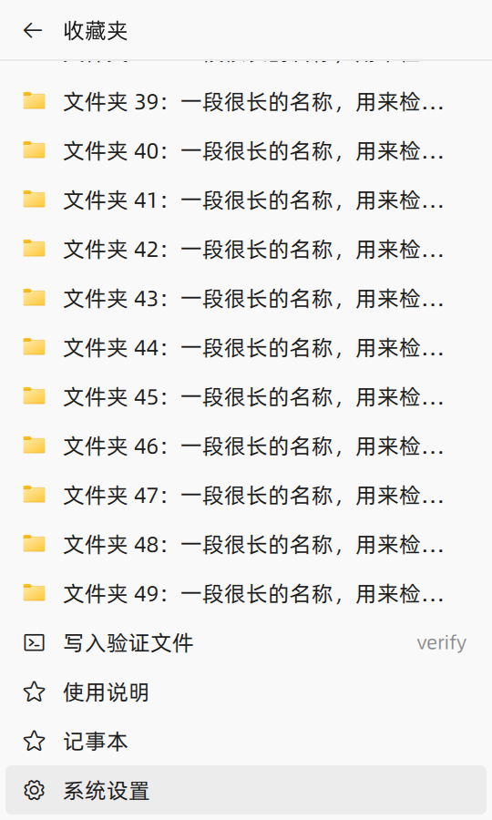
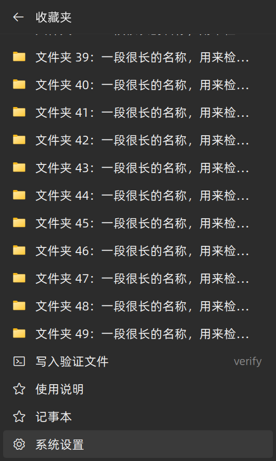

# #156–#158 验证记录

日期：2026-11-01。基线：`760e9f2` 及本地既有未提交修改。本次只做修复和验证，没有发布新版本。

## 问题与实现

### #156：收藏夹、命令和菜单层级

[原 issue](https://github.com/LingCore/WinShun/issues/156) 希望空白处菜单能使用自定义命令，以名称、图标和二级页面组织内容。

原菜单已经能在列表末尾执行命令，但收藏区只列文件夹；文件夹、最近、窗口和命令平铺，收藏和命令各截断到 12 项，路径挤占显示空间。

- 入口改为“收藏夹 / 最近的文件夹 / 已打开的文件夹”，在同一个不抢焦点的窗口内进入二级页面。收藏夹包含文件夹、文件、应用、系统位置和自定义命令，保留收藏排序，不再截掉第 12 项之后的收藏。
- 复用 `FileIconProvider` 和现有 `Glyph`、字体及主题。行内显示名称和关键词，悬停查看完整路径或命令。没有另建图标缓存或执行通道。
- 收藏用虚拟列表按需创建可见项；高度受工作区和 600 逻辑像素双重限制。长名称省略，长关键词有宽度上限，末项可通过滚动或 End 到达。
- 右方向键、回车进入；左方向键、退格、Esc 返回；首页 Esc 关闭。后台按键路由同步接管新增导航键，避免输入落到原窗口。
- 命令点击仍走生产 `shell::runCustom`，保留静默、管理员和工作目录选项；`{query}` 接收当前文件夹。触发时按收藏身份重新查找，已移除的项给出反馈，不按旧行号执行其他项。关闭收藏入口时，命令一起隐藏。
- 更新中英文说明、设置文案和翻译。初次交付没有重做原生托盘菜单；用户随后补充托盘截图，该入口已单独统一字体、配色和图标，详见 [托盘菜单实现与验证](tray-menu-validation.md)。两个入口的验证范围分别记录。

### #158：系统圆角与叠加描边

[原 issue](https://github.com/LingCore/WinShun/issues/158) 报告桌面美化工具调整圆角后，应用自绘黑边不能跟随。

原实现用 `DWMWA_COLOR_NONE` 关闭系统边框，再由 `WindowEdge.qml` 画固定半径的描边。当前 Windows 11 的直角、圆角均由 DWM 绘制边框和阴影，仅 Windows 10 保留 QML 回退。后续用户报告直角纯弹窗异常，实测根因是原生框架缺失；补上 `WS_CAPTION` 固定框架后，两种模式可统一使用系统默认边框，详见 [最新直角窗口验证及历史修正](square-windows-validation.md)。系统属性的适用范围与默认颜色语义见 [Microsoft 文档](https://learn.microsoft.com/en-us/windows/win32/api/dwmapi/ne-dwmapi-dwmwindowattribute)。

本节初次验证仅覆盖 Windows 11 下 QML 描边不可见、客户区没有额外描边和原生圆角属性，漏掉了直角纯弹窗的实际轮廓；这些历史测试通过不能证明完整边框正确。后续补上桌面合成检查，覆盖菜单、可缩放窗口、设置标题栏和模式来回切换。没有安装或实测报告者使用的美化工具，也没有 Windows 10 实机环境。

旧的统一自绘建议已在 `docs/pitfalls.md` 原记录旁标为历史方案，避免后续重复套用。

### #157：信息不足，不能认定原问题已解决

[原 issue](https://github.com/LingCore/WinShun/issues/157) 只有“直接打字搜索没有效果，电脑是 win10”的标题，没有正文或评论。无法判断是搜索框、资源管理器文件列表还是开始菜单，也没有版本、开关状态或实际输入。

代码检查确认一处遗漏：输入监听能识别 Windows 10 的 `SearchApp.exe` / `SearchUI.exe`，前台窗口唤起却未把它们作为需先关闭的系统搜索浮层。两处改为复用 `foreground` 中的宿主识别，覆盖 Windows 10、11 的搜索宿主，同时保留其他系统浮层。

宿主分类、生产搜索和按键路由回归通过，但没有复现报告者场景，也没有 Windows 10 端到端验证。继续排查最少需要：输入发生的位置、Win顺 版本与相应开关状态，以及一次具体输入和实际画面。初次验证时未向 GitHub 回复；后续用户授权后的回复见下文。

## GitHub 回复（后续）

用户明确授权回复后，已以 LingCore 账号发布并逐条读回核对：[156](https://github.com/LingCore/WinShun/issues/156#issuecomment-6553540458)、[157](https://github.com/LingCore/WinShun/issues/157#issuecomment-6553540685)、[158](https://github.com/LingCore/WinShun/issues/158#issuecomment-6553540843)。156、158 说明本地开发版的实现和验证范围，明确尚未正式发布；157 请求补充复现场景，不认定已修复。未关闭 issue。

## 验证

环境：Windows 11、MSVC 2022、Qt 6.12.0、C++20。独立构建位于 `D:\WinShun-validation-issues156-158-20261101`。菜单使用真实 Windows 窗口、D3D11、项目字体和图标提供器；设置和搜索预览使用临时配置。

| 检查 | 结果和证据 |
| --- | --- |
| Release 构建 | `WinShun` 及相关测试目标构建成功；最终日志为独立构建目录中的 `build-complete.log`。编译器仍有已有 Qt 头文件等警告，不宣称整个工程零编译警告。 |
| 真实菜单 | [5 项通过、0 失败、0 跳过](validation/issues156-158-20261101/menu-virtualized.txt)。亮暗主题、54 项收藏、鼠标进入、键盘进退、末行可见、关闭重开、组开关、删除后的身份检查；真实 PowerShell 临时命令写入文件，浏览和取消不执行。引擎警告为零。 |
| 真实键盘路由 | [6 项通过、0 跳过](validation/issues156-158-20261101/keyrouter-final.txt)。显式启用 `WINSHUN_KEYROUTER_LIVE=1`，只向自建接收窗口发送受保护按键，验证左右方向键与退格由菜单接收，源窗口不收到这些键。 |
| 外观 | [100%、125%、150%、200% 四个测试均通过](validation/issues156-158-20261101/appearance-final.log)，软件渲染；包括系统宿主分类、原生圆角设置和 QML 客户区描边。分数像素尺寸只比较完整覆盖的边缘像素，不放宽颜色误差。 |
| 收藏、命令与核心 | `tst_favorites`、`tst_commandlaunch`、`tst_commandicons`、`tst_core` 均通过，原始结果在独立构建目录的 `regressions.log`；该日志中的早期外观测试失败已由上述最终结果取代。 |
| 生产搜索 | [`tst_searchnavigation` 通过](validation/issues156-158-20261101/search-navigation-final.log)。使用生产 Main.qml、Launcher 和真实临时文件，验证搜索及键盘交互；此入口不等同于 Windows 10 的全局打字触发。 |
| 中英文设置 | [英文打开页面](validation/issues156-158-20261101/settings-en-open.log)、[英文收藏页面](validation/issues156-158-20261101/settings-en-favorites.log)、[中文打开页面](validation/issues156-158-20261101/settings-zh-open.log) 均为 0 警告、退出码 0。新增收藏菜单选项可搜索并正确跳转；修正旧预览在英文模式仍搜索中文“收藏”的测试输入。 |
| 静态检查 | `qmllint` 对 `FolderMenuWindow.qml`、`WindowEdge.qml` 无输出、退出码 0；`git diff --check` 通过。 |

菜单的命令执行和键盘路由来自实际运行；截图只作为外观证据。应用、文件和系统位置的展示已覆盖，未逐一启动真实用户应用或打开用户文件。此次没有重新全面验证所有第三方文件管理器或真实 UAC 提升操作。

## 界面证据

以下为实际组件截图，使用隔离测试数据，不是新版发布宣传图。客户区截图不包含 DWM 外框。

| 亮色首页 | 暗色首页 |
| --- | --- |
|  |  |

| 长列表末项与命令（亮色） | 长列表末项与命令（暗色） |
| --- | --- |
|  |  |

设置页面：[中文](validation/issues156-158-20261101/settings-dialogs-zh.png)、[English](validation/issues156-158-20261101/settings-dialogs-en.png)。

## 用户状态保护

原运行实例 `build/release/WinShun.exe` 未停止、未覆盖。构建和执行验证使用独立目录；临时配置、命令输出、收藏文件和接收窗口均由测试自建。未写用户剪贴板或用户收藏，未执行发布、提交或推送。

工作开始前保存了已有差异。27 个不相关的既有已修改文件与初始差异逐字节一致；README、使用说明、App.cpp、Preview.cpp 和 tests/CMakeLists.txt 五个共享文件使用局部补丁保留原编辑，见 [保护检查](validation/issues156-158-20261101/preservation.json)。
