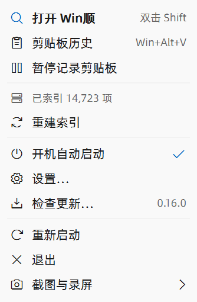
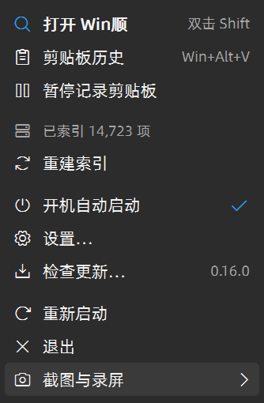

# 托盘右键菜单：风格统一与图标（2026-11-01）

用户截图指出的是通知区托盘菜单。此前 #156 的文件夹菜单改造没有覆盖这一入口，不能将两者混为同一项已完成工作。

## 最新：首尾留白

根据用户反馈，主菜单和插件子菜单首尾各增加 6 个逻辑像素的留白，保留紧凑字号和普通行高。使用禁用的自绘分隔项承载空白，不绘制分隔线，不占用命令 ID，点击留白不会执行首尾命令。原生子菜单有前置分隔项时打开后没有初始命令焦点，按向下键进入第一项；测试分别覆盖第一项执行、经过禁用项及 Esc 返回。

最新 [16 项菜单测试全部通过](validation/tray-menu-20261101/tray-menu-padding.txt)，包括首尾留白等高、禁用分隔语义、亮暗主题及直角／圆角；已检查真实原生窗口截图。相同中文夹具在 150% 显示缩放下为 334×510 设备像素。主程序 [构建](validation/tray-menu-20261101/build-padding.log) 和 [测试构建](validation/tray-menu-20261101/build-padding-test.log) 成功；正常退出旧实例、备份、替换并启动后核对哈希，见 [当前运行记录](validation/tray-menu-20261101/build-padding.json)。

## 实现

- `App::showTrayMenu` 保留原来的菜单数据、顺序和命令分发，改用 `traymenu::popup` 绘制。原生菜单循环继续负责鼠标、键盘、子菜单、屏幕边界与关闭。
- 从生产 `Theme.qml` 读取背景、选中底色、文字、强调色、字体尺寸和圆角；使用应用字体及现有 Phosphor 图标。按用户后续要求，托盘采用紧凑规格：正文 14、快捷键／状态文字 12、普通行高 28、图标 14（均为逻辑像素）。其他 QML 菜单保留原有密度。
- 图标、名称、快捷键／版本、勾选状态分别对齐。默认入口加粗，索引等信息采用次级文字，长名称省略并保留完整的辅助功能名称。
- 原生窗口继续承担边框和阴影，遵循现有直角／圆角设置。Windows 自动附加的子菜单箭头不一定跟随自绘颜色，因此在原生绘制和选中重绘完成后，使用同一绘制函数补画 Phosphor 箭头；不替换原生子菜单导航。
- `MSAAMENUINFO` 位于实际 `itemData` 的首部；名称、禁用和勾选状态通过 Windows 辅助功能接口读取验证。处理唯一助记键和相同首字母的循环选择。
- 菜单及画刷按弹出生命周期释放，窗口子类和事件钩子退出时解除；陌生的 `itemData` 交回原有窗口过程。

原生菜单的绘制、键盘和辅助功能契约参考 [Microsoft 菜单文档](https://learn.microsoft.com/en-us/windows/win32/menurc/using-menus)、[自绘菜单辅助功能文档](https://learn.microsoft.com/en-us/windows/win32/winauto/exposing-owner-drawn-menu-items) 及 [GetMenuBarInfo](https://learn.microsoft.com/en-us/windows/win32/api/winuser/nf-winuser-getmenubarinfo)。

## 风格与紧凑版验证（此前阶段）

环境为 Windows 11、Qt 6.12.0、MSVC 2022、C++20；真实显示缩放 150%（原生菜单 DPI 144）。

| 检查 | 当前结果 |
| --- | --- |
| 完整 Release 构建 | `WinShun`、`WinShunCaptureApp` 及相关测试目标构建成功，见 [构建日志](validation/tray-menu-20261101/build.log) 和 [最终构建日志](validation/tray-menu-20261101/build-final.log)。紧凑调整仅影响托盘 C++ 绘制，最新主程序与测试再次构建成功，见 [紧凑版构建](validation/tray-menu-20261101/build-compact.log) 和 [测试构建](validation/tray-menu-20261101/build-compact-test.log)。不宣称全工程零编译警告。 |
| 原生托盘菜单 | 紧凑版 [15 passed、0 failed、0 skipped](validation/tray-menu-20261101/tray-menu-compact.txt)。显式启用 `WINSHUN_TRAYMENU_LIVE=1`，直接运行生产 `traymenu::popup`，覆盖亮暗主题、直角／圆角、英文长名称、选中状态、禁用项、跨禁用项导航、插件子菜单、Esc、助记键、重复首字母以及 MSAA 名称和状态。 |
| 子菜单箭头 | 从真实原生菜单截图检查箭头区域的对比方向和强度，覆盖亮暗主题及选中状态；薄斜线允许正常抗锯齿，未用逐像素纯文字色作为错误前提。 |
| 共享菜单回归 | [7 项通过](validation/tray-menu-20261101/folder-menu.txt)，包括亮暗主题、直角／圆角、长收藏列表、进退导航和独立临时命令。 |
| 原有外观回归 | [四档软件渲染检查通过](validation/tray-menu-20261101/appearance.txt)，没有将 `QT_SCALE_FACTOR` 当作 Win32 菜单的真实显示 DPI。 |
| 静态检查 | 两个使用共享行高的 QML 菜单及生成模块内的 `Theme.qml` 分别通过 `qmllint`，无输出、退出码 0；`git diff --check` 通过。 |
| 新版运行 | 初版正常退出旧 Win顺 后替换主程序及两份截图插件 DLL，核对 SHA256，并启动新版、检查设置页正常响应，见 [初版记录](validation/tray-menu-20261101/build.json)。紧凑版只更新主程序，备份后正常重启并核对 SHA256，见 [当前记录](validation/tray-menu-20261101/build-compact.json)。未覆盖用户配置或 `data`。 |

紧凑版正文由 16 缩至 14，行高由 36 缩至 28；图标、快捷键、状态行、分隔和水平间距一并缩小。相同中文夹具、150% 真实显示缩放下，窗口从 382×630 缩至 334×492 设备像素，高度减少约 22%；英文长名称窗口从 652×630 缩至 562×492。上述共享 QML 菜单和软件外观结果来自初版；本轮没有修改共享 QML，未重复执行无关回归。

托盘测试使用隔离菜单数据，命令只返回测试 ID；没有为测试切换用户的开机自启、剪贴板记录或重建索引。Windows 原生键盘导航可以聚焦禁用项，回车不会执行它；测试依据实测行为验证，未把“自动跳过所有禁用项”作为原生菜单的前提。

桌面自动化未提供可定位的系统托盘窗口，因此未将“通知区图标右击 → 新菜单 → 真实业务操作”整条链路记为已完成实机自动验证。生产 `App::showTrayMenu` 已接入新绘制路径；上述菜单测试运行真实 Win32 菜单，而非离屏模拟控件。Windows 10、其他原生显示 DPI 和第三方菜单美化工具未实测。没有执行发布、提交或推送。

## 界面证据

以下为真实原生窗口截图，内容为测试夹具，索引数量和插件名称不代表用户配置。

| 亮色 | 深色选中态 |
| --- | --- |
|  |  |

[亮色直角](validation/tray-menu-20261101/padded-light-square.png)、[深色直角](validation/tray-menu-20261101/padded-dark-square.png)、[英文长名称](validation/tray-menu-20261101/padded-english-long.png)。此前截图与日志保留供前后对照。
