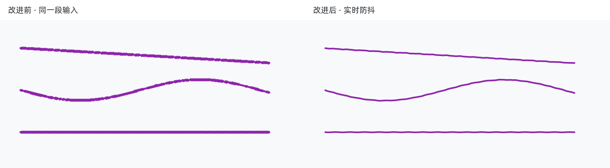

# 截图画笔实时防抖：调研与验证

日期：2026-11-01（北京时间）。环境：Windows 11、MSVC 2022、C++20、Qt 6.12.0，Release 构建。此次修改仍在工作区，未发布或安装到用户正在运行的程序。

## 现象与原因

用户反馈画笔细抖。实际生产路径是 `CaptureOverlay` 的 MouseArea → `CaptureSession` → `AnnotationModel` → `AnnotationCanvas`／`Compositor`。原实现逐像素收点、中点二次曲线圆滑、松手后以 0.75 图像像素做 RDP 简化。中点曲线主要圆滑折角，无法充分消除密集输入的细抖；松手简化控制点也可能改变已显示的曲线。

新增回归在旧实现上失败：带 ±2 px 高频扰动的同一段输入，实时曲线的抖动 RMS 为 1.44062 px，处理前后完全相同。该结果证明的是固定轨迹的生产模型行为，不代表测量了用户附件中的原始鼠标数据。

**后续纠正（用户强调“主要是线不平滑”，同日）：** 第一轮只降低了偏离基线的幅度，中间控制点仍过密。新增等弧长取样的二阶差分检查后，第一轮曲线为 0.611683 px，未达到平滑度要求；不能拿此前“抖动下降 71%”代替线条整体平滑。第一轮对照图保存在 `comparison-stage1.png`。附件笔迹实际含 183 种紫色／边缘混合色，原有合成器也确实开启了抗锯齿，因此没有通过模糊整张截图或改全局抗锯齿来掩盖轨迹问题。

## Grok 与一手源码核对

已使用用户浏览器中登录的 Grok 提交调研，见 [本次对话](https://grok.com/c/ee1e0fcd-31e1-4e8d-a50c-dba2708a4e9b)。提示词见 [grok-prompt.txt](grok-prompt.txt)。筛选窗口为 2025-11-01 至 2026-11-01；通过 GitHub API 另外检查仓库提交与源码，而非以网页抓取日期代替项目活跃度。

以下提交日期均为北京时间，指核对到的近期提交，不意味着画笔算法本身刚刚改动：

| 项目 | 近期提交 | 源码事实与取舍 |
|---|---|---|
| Flameshot | [2026-10-31，8f4fcf3](https://github.com/flameshot-org/flameshot/commit/8f4fcf39662faa4d551f7a8e6b4af9f854eb811d) | [AbstractPathTool](https://github.com/flameshot-org/flameshot/blob/8f4fcf39662faa4d551f7a8e6b4af9f854eb811d/src/tools/abstractpathtool.cpp) 持续追加输入点；这层没有前置防抖，不能仅凭它是成熟截图工具就认为轨迹已经平滑。GPL-3.0，未复制代码。 |
| kImageAnnotator（ksnip 的标注库） | [2026-10-21，ba5692e](https://github.com/ksnip/kImageAnnotator/commit/ba5692e5c921026b7cf4052657744c6ab08a528d) | [AbstractAnnotationPath](https://github.com/ksnip/kImageAnnotator/blob/ba5692e5c921026b7cf4052657744c6ab08a528d/src/annotations/items/AbstractAnnotationPath.cpp) 在 finish 调用 smoothOut；[ShapeHelper](https://github.com/ksnip/kImageAnnotator/blob/ba5692e5c921026b7cf4052657744c6ab08a528d/src/common/helper/ShapeHelper.cpp) 按距离筛点后构造圆滑路径。借鉴采样与曲线分工；本项目要求实时和松手一致，因此不采用松手才改形。LGPL-3.0，未复制代码。 |
| ShareX | [2026-11-01，1938aa3](https://github.com/ShareX/ShareX/commit/1938aa3a1c420c97e8cbb5ba329f1af417810ad5) | 新图像编辑器的 [FreehandAnnotation.Visual](https://github.com/ShareX/ShareX/blob/1938aa3a1c420c97e8cbb5ba329f1af417810ad5/ShareX.ImageEditor/Presentation/Rendering/AnnotationVisuals/FreehandAnnotation.Visual.cs) 使用中点二次曲线和圆接头，与现有曲线策略相近。保留现有合成器，改进输入层。GPL-3.0，未复制代码。 |

另外确认 tldraw、Excalidraw 均有近一年更新；查看了 tldraw 当前仓库的 getStrokePoints 入口，但没有移植其整套笔刷或将其测试当成本项目验证。

Grok 建议优先考虑 One Euro／EMA、距离阈值、强制保留首尾，并提醒 pulled-string 的拖尾和松手 RDP 的改形风险。它没有充分核实 ShareX 的具体插值和 kImageAnnotator 的平滑内部实现；这些以本次直接读取的源码为准。它将 kImageAnnotator 活跃时间写到 2025-11，已由上表真实的 2026-10 提交纠正。

工程选择：使用小半径的空间稳定器和实时尾端，不引入时钟、时间滤波状态或第三方依赖。此选择是本项目的判断，不是 Grok 给出的测试结论，也不声称在所有书写场景都优于 One Euro。

## 最终实现

- `StrokeSampler` 每次输入都推进亚像素空间滤波，再沿滤波轨迹每 4 逻辑 px 保留一个控制点；滤波半径为 4 逻辑 px，经 `deviceDpr / zoom` 转为图像 px。两层有独立状态，避免直接按间距挑原始输入导致噪声混叠。最后两个临时点为滤波引导点和真实指针，前面的稳定采样点不再改写；因此当前尾端仍即时跟随指针，松手也不补做全笔拟合。
- 锚点计算保留亚像素，起终点仍用已有像素中心约定；继续复用二次曲线、圆头、抗锯齿、瓦片和导出合成器。
- 自由画笔／荧光笔松手后不再进行 RDP 二次改形。Shift 直线走原来的约束路径；涂抹打码仍走原覆盖与简化逻辑，避免改变遮盖范围。
- 脏区包含改变前后的完整尾段；进出水平／竖直像素对齐时回退完整重绘，避免旧尾段残留。
- 已有项目仅加载已存几何，不重新做防抖；新锚点可由既有 JSON 坐标格式无损保存，无格式升级。

极小折角会在上述几像素的空间尺度内被圆滑；这符合截图涂画的默认取舍，并不提供 CAD 式精确折线。需要精确直线或节点时继续使用 Shift 或直线工具。原有开始拖动的阈值保持不变。

## 验证结果

| 检查 | 当前结果 |
|---|---|
| 实时抖动回归 | 画笔与自由荧光笔均为原始 1.44062 → 当前 0.268826 px RMS，下降约 81% |
| 整体平滑回归 | 每 1 图像 px 沿弧长取样、排除两端 10 px，二阶差分 RMS 从第一轮 0.611683 → 当前 0.0171215 px，下降约 97%；同一轨迹存储点数 200 → 57。该指标衡量细碎弯折，不是通用主观评分 |
| `tst_annotate`、`tst_annotmodel`、`tst_editor` | CTest 3/3 通过，总耗时 12.59 s；另外新增的 Shift 中途切换、取消后重画检查通过 |
| 纯几何 | 短划、回环、重复点、稳定前缀、拖尾上界、0.5／1／1.5／2／4 倍尺度一致性通过 |
| 生产模型 | 100／150／200% DPR × 50／100／200% 编辑缩放；逐步脏区与全图一致、松手不改形、亚像素 JSON 往返、导出、撤销重做通过 |
| 真实截图 QML + D3D11 | 100／150／200% 各 1860 个 move 事件，均生成三条轨迹；松手几何一致；覆盖笔迹的 660×300 逻辑 px 可见区域与导出合成器逐像素一致；QML 警告均为 0 |
| QML move 处理 p95 | 100%：0.055 ms；150%：0.074 ms；200%：0.101 ms。是固定轨迹的事件处理计时，不是屏幕帧率或端到端输入延迟 |
| Windows 原生鼠标 | computer-use 在独立的 150% 实际预览窗口发送两次拖动，生成两个画笔对象并导出；日志有真实按下／移动／松开，0 QML 警告 |

构建中有 Qt 头文件不可达代码及现有 `PinTools.cpp` 的 deprecated API 警告，均不来自新增画笔代码。测试首次启动时本地部署目录只有 windows 平台插件；显式指定开发套件的插件目录后执行上述回归，未更改用户程序的部署文件。

对照图两侧使用同一批输入、同一个生产合成器：左侧重放旧的“原始采样 + 松手 RDP”，右侧是当前模型的实时防抖结果，不是重绘用户附件。



## 实际绘制流畅度与资源占用

使用新增 `--brush-performance` 入口，显示真实 CaptureOverlay，以正常事件循环在 12 秒内最多每 2 ms 发送一次输入，实际约 5900 次；D3D11、150% DPI、240 Hz 屏幕。分别检查空画布，以及预先存在 50 个矩形、5 个已缓存马赛克的画布。CPU 取自 Windows 进程 CPU 时间，内存取自进程私有提交与工作集；帧间隔来自实际 `frameSwapped`，画布绘制耗时复用现有 `AnnotationCanvas` 计量。

| 指标 | 第一轮空画布／复杂画布 | 当前空画布／复杂画布 |
|---|---|---|
| 持续绘制后笔迹点数 | 1959／1983 | 603／603 |
| 画布绘制 p95 | 1.56／1.61 ms | 0.86／0.94 ms |
| 实际呈现帧间隔 p95 | 4.74／4.64 ms | 4.76／4.92 ms |
| 帧间隔超过 33.34 ms | 0／0 | 0／0 |
| CPU，占一个逻辑核 | 48.57%／44.79% | 58.98%／55.71% |
| 进程私有提交峰值 | 164.19／173.96 MiB | 165.26／173.04 MiB |
| 描画阶段私有提交增量 | 4.80／1.20 MiB | 3.64／3.02 MiB |

机器为 i9-14900HX，24 核、32 逻辑处理器；当前 CPU 折算全机约 1.74–1.84%。因为总 CPU 没有随绘制耗时一起下降，额外复核一次当前空画布：绘制 p95 1.11 ms、帧间隔 p95 4.94 ms、最大 12.45 ms、0 个超过 33.34 ms 的间隔、603 个笔迹点、CPU 56.25% 单核（全机约 1.76%）、私有提交峰值 163.71 MiB。这确认了流畅度和资源量级，但**不支持“总 CPU 已优化降低”的结论**，也未归因该差异；不能只根据点数减少推断整体进程占用下降。

当前停止绘制后的 1.5 秒短窗口里，CPU 为单核 2.08–9.37%，折算全机约 0.07–0.29%；不据此声称长期空闲功耗为零。生产采样器仅保存固定大小的状态，没有新增后台线程、轮询或定时器；500 Hz 输入和内存定时采样只属于显式开启的性能预览。GPU 显存和长期真人使用未在本轮量化。

原始 JSON 和画布计量日志以 `performance-stage{1,2}-{plain,busy}.{json,log}` 保留；复核为 `performance-stage2-plain-recheck.*`。前一轮 `native-150.log` 也已由当前构建的实际原生鼠标记录更新。

## 复现入口

在已初始化 MSVC 的 PowerShell 中构建：

```powershell
cmake --build build/release --target tst_annotate tst_annotmodel tst_editor WinShunCaptureApp --parallel 6
$env:QT_PLUGIN_PATH = 'C:\Qt\6.12.0\msvc2022_64\plugins'
$env:QT_QPA_PLATFORM_PLUGIN_PATH = "$env:QT_PLUGIN_PATH\platforms"
ctest --test-dir build/release -R '^(tst_annotate|tst_annotmodel|tst_editor)$' --output-on-failure -j 2

& .\build\release\WinShunCapture.exe --app-dir "$PWD\build\release" `
    --preview-capture-tools "$PWD\build\brush-recheck-150" --brush --scale 1.5 --renderer d3d11

& .\build\release\WinShunCapture.exe --app-dir "$PWD\build\release" `
    --preview-capture-tools "$PWD\build\brush-perf-recheck" --brush-performance --busy --scale 1.5 --renderer d3d11
```

将 scale 换成 1／2 可验另两档；加 `--interactive` 可在独立预览窗口用鼠标画，45 秒后自动保存并退出。该入口使用合成底图，不注册热键、不改系统剪贴板或用户配置、不退出用户的 Win顺。当前图片与输入结果在 `build/brush-smooth2-{100,150,200}`、`build/brush-native-stage2-150`；第一轮 `build/brush-validation-*` 为历史结果。

未覆盖：真实手写笔压感、跨物理显示器的混合 DPI 操作，以及长时间真人手绘的主观试用。程序没有为此新增压力模拟或笔刷设置面板。
