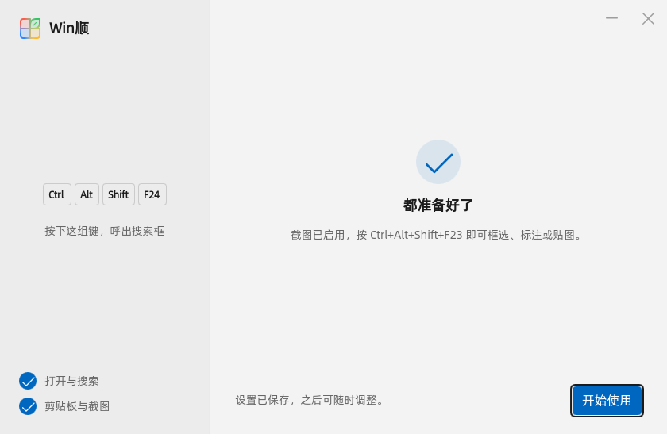
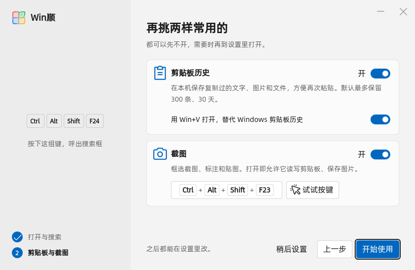

# 截图组件随安装包附带：首次引导不联网安装（2026-11-24）

起因：首次引导里选了截图，组件要从插件库下载；连不上网就装不上，装好程序还得再下载一次。

## 做法

- `winshun.capture` 仍是插件库插件（可在线更新、可卸载），安装包、离线安装包和便携版另带一份解包副本 `library-plugins\winshun.capture`。
- 引导里打开截图、点 **开始使用** 后，`Onboarding::copyOfCapture` 找到副本就经 `PluginSettings::installFrom` 装进用户插件目录并启用，不联网；之后由后台插件更新照常升级。
- 没有副本、副本装不上（日志写明原因）时，照旧从插件库下载。引导页有副本时不再写“首次开启会下载组件”。
- 副本以原文件放进安装包，不单独压成 zip：安装包本身是 LZMA2 固实压缩，能和主程序里重复的内容（图标字体、共用界面代码）一起去重；单独 zip 反而更大，而且每个版本整包都变，会让每次应用内增量更新多带约 3 MB。安装器先清空 `library-plugins` 再装，旧副本的文件不会残留。

## 体积（同一份部署，Inno Setup 6.7，lzma2/ultra64 固实）

| | 大小 |
|---|---|
| 安装包，不带截图副本 | 33,105,612 字节 |
| 安装包，带截图副本 | 34,269,857 字节（**+1.16 MB**） |
| 截图组件原文件 | 7,300,766 字节 |
| 单独打成 .wsplugin（deflate） | 约 3.0 MB |
| 单独 LZMA2（xz -9e） | 约 2.27 MB |

## 实测

`tools/verify-onboarding.ps1`（真实程序与截图组件，隔离配置）8 个用例全部通过：

| 用例 | 情形 | 结果 |
|---|---|---|
| included | 插件库不可达 + 有副本 | 从副本安装（13 ms），截图已启用，真实组件注册了快捷键 |
| included-broken | 副本的 plugin.json 损坏 + 插件库可用 | 日志记下原因，改从插件库装好 |
| capture / retry | 无副本，插件库可用 / 先断网再重试 | 从插件库装好 |
| offline / incompatible | 无副本，插件库不可达 / 版本不兼容 | 显示原因与重试 |
| english / english-capture | 英文、深色、150%，有副本 | 文案与布局正常，从副本装好 |

日志里实际写的是：`Onboarding: screenshot 1.1.33 installed from …\copies\winshun.capture in 13 ms`。

`tools/verify-installer.ps1` 6 个用例全部通过；新增检查：版本 1 带的旧副本文件在普通升级和增量升级后都被清掉，安装因文件被独占而放弃时版本 1 的副本完好。

顺带修复：引导探针自 1d2b310c 起每个用例都以退出码 1 结束——`showOffScreen` 给已显示的引导窗口改窗口标志，Qt 重建原生句柄，`WindowFrame` 为此记一条警告。现在这条由探针自己引起的警告计为预期。

## 未覆盖

- 没有在本机真实安装正式版安装包（会动到用户正在用的 Win顺）；安装器的文件规则由 `verify-installer.ps1` 真实运行安装程序验证。
- 便携版走同一代码路径（副本在程序目录旁），未单独解压便携包实测。
- 第一次 capture 用例跑时“真实组件注册快捷键”的 5 秒检查失败过一次，之后全套重跑未再出现（走的是未改动的插件库路径）。
