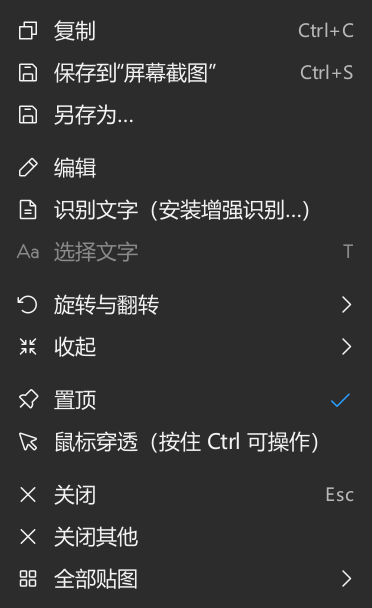
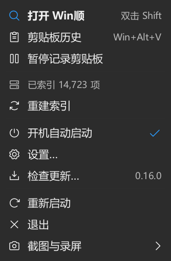
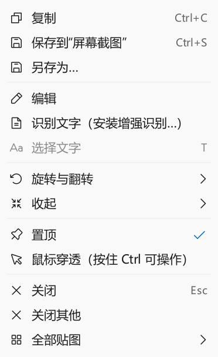
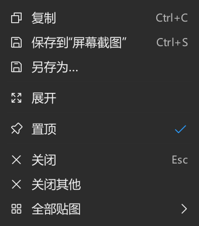

# 贴图右键菜单统一（2026-11-02）

用户提供的贴图菜单使用系统默认字体和布局，托盘菜单已经使用 Win顺 的主题字体、Phosphor 图标和自绘菜单。两条生产路径不同，是风格不一致的直接原因。

## 实现

`PinManager` 继续负责命令、分组、勾选与可用状态，补齐所有命令及子菜单的图标。`CaptureApp::pins()` 注入呈现回调，复用 `TrayMenu.cpp` 的原生菜单循环；未复制另一份绘制代码。二者共用 Theme 的颜色和字体、28 逻辑像素行高、14 像素图标、6 像素上下留白、分隔线、快捷键次级文字、右侧勾选与子菜单箭头。外框圆角沿用现有 Windows DWM 实现。

截图插件直接编译已有组件，不新增 Qt Quick 菜单窗口。独立预览未提供宿主回调时仍可用系统菜单。Windows 资源管理器的 Shell 扩展菜单不在此改动范围。

## 验证

- Qt 6.12.0 / MSVC 2022 Release，Windows 本机 150%（原生菜单 DPI 144）。只构建截图插件 DLL 和相关测试，用户的 Win顺、截图、贴图实例保持运行。
- [19 项菜单检查通过](verified-tests.txt)，无跳过：亮暗主题、圆角 / 方角、英文长标题、选中态、禁用项、勾选、MSAA 名称及状态、助记符、方向键、子菜单选择与 Esc 取消。
- 新增三种真实 `PinManager` 路径：亮色完整贴图、暗色完整贴图、暗色收起贴图。各菜单的所有命令图标必须存在；检查实际行高，原生菜单方向键 / Enter 选择复制，最后回到贴图的复制回调，图像与测试图相等。复制回调仅保存进测试进程内存，不改系统剪贴板。
- 使用生产截图插件的 `windows:fontengine=freetype` 重跑[11 项外观检查](freetype-tests.txt)，无跳过。下方截图来自这次真实原生菜单客户区，包含 OCR 未安装时的提示和禁用状态；外部圆角由测试另行读取 DWM 属性断言。
- 隔离插件 initialize、pin、trayMenu 协议冒烟成功，托盘状态确认测试贴图已存在；通过 shutdown 正常退出。电脑工具的窗口列表未提供该原生工具窗口，因此实际菜单输入与截图证据来自上面的生产 `PinManager` 集成测试，未把协议冒烟当成外部鼠标端到端证据。
- 首次命令行启动 GUI 测试没有正确等待退出，随后以隐藏方式启动又导致第一个窗口不暴露；这两次不算通过。改为正常显示并等待测试进程退出后，得到上述结果。

最终 DLL 指纹见 [build.json](build.json)。没有发布或替换正在运行的插件。未验证不同显示器之间的菜单移动，也未改变用户的高对比度系统设置。

## 同后端对照

| 贴图右键菜单 | 托盘菜单 |
| --- | --- |
|  |  |

| 亮色贴图菜单 | 收起后的菜单 |
| --- | --- |
|  |  |
