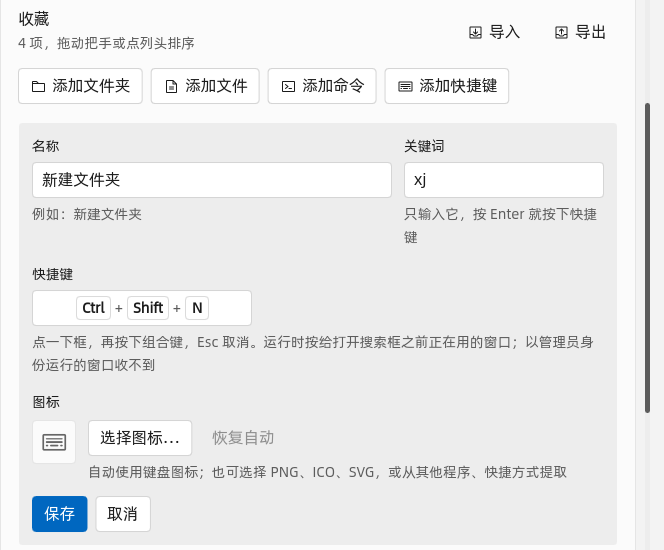
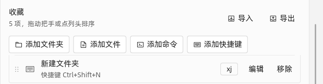
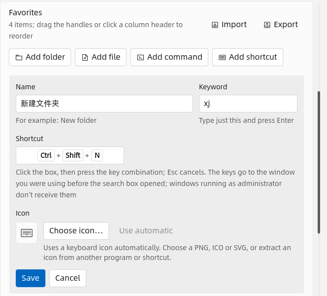

# 收藏快捷键（设置 › 收藏夹 › 添加快捷键）验证

2026-11-28，分支 `favorite-keys`，构建目录 `build/favorite-keys`（Release，Qt 6.12.0）。

需求：收藏夹里存一个组合键，输入关键词按 Enter 就按下它，不用再写脚本。

## 单元测试

`ctest -R ^tst_favorites$`：通过（含新增 `keyChordsWrittenAndRead`、`keyChordsFromQt`、`keyChordsPressed`、`keyChordsAsCommands`、`shortcutFavorites`）。覆盖：组合键的读写与非法写法、录制框交来的 Qt 键（Shift 符号、小键盘、Backtab）、按键顺序与扩展键、`Ctrl+Alt+Del` 不可发送、`winshun:keys/…` 收藏的文件往返与清掉命令开关、只认完整关键词且排第一。

## 实跑：关键词 + Enter 按到另一个程序的窗口

`WinShun.exe --probe-runtime <dir> --favorite-keys-check --renderer d3d11`（隔离配置，与正在运行的 Win顺 并存）：收藏 `Ctrl+Alt+Shift+F17`（运行前确认没人注册），关键词 `wsfavkeys`；另一进程的 WinForms 窗口到前台，启动器在它上面打开并输入关键词，真实按下 Enter。结果见 [favorite-keys.json](favorite-keys.json)，连续两次通过：

- 启动器收起，原窗口回到前台；
- 原窗口按顺序收到 `Control`、`Alt`、`Shift`、`F17`，没收到 Enter；
- 结束后没有键处于按下状态。

## 设置页

`WinShun.exe --preview-settings <dir> --keys-form --renderer d3d11`（离屏，100%、150%、英文各一次）：点框后录制状态接管键盘（`recordingHotkey`），只按 Ctrl 时继续等，`Ctrl+Shift+N` 录成并停止录制；保存后列表多出一行，再点“编辑”显示原来的组合键。

## 未实跑

- 文件夹菜单（资源管理器空白处双击）里点快捷键收藏：与搜索框共用 `KeyPresser`，目标为菜单所在的资源管理器窗口，未在本机实跑（会打扰正在使用的资源管理器）。
- 以管理员身份运行的目标窗口：代码按 `integrity::higherThanOurs` 拒绝并通知，未实跑。
