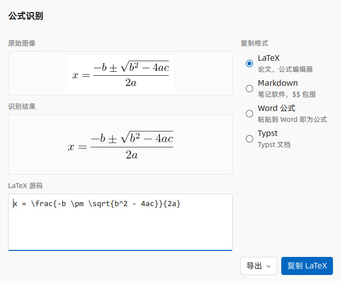
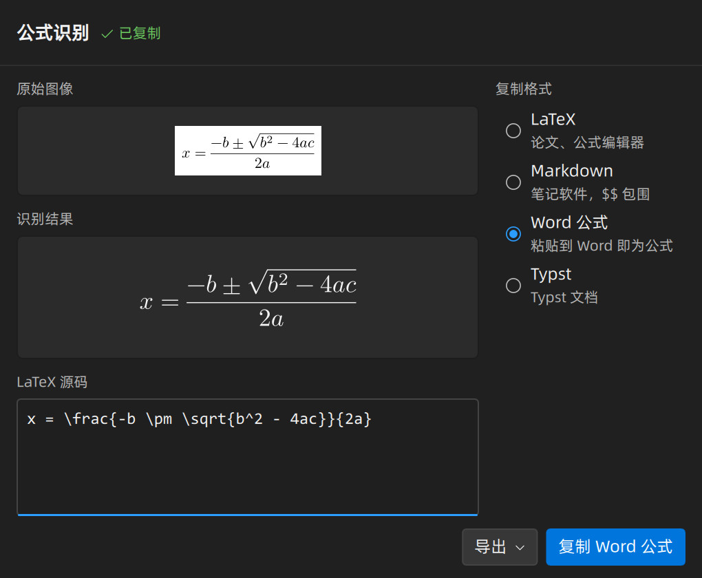
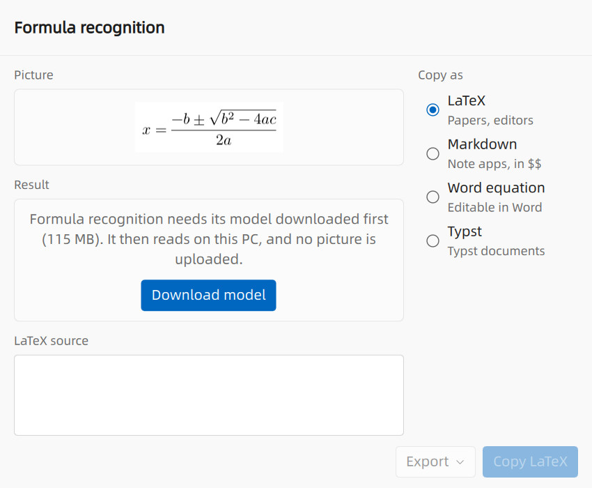
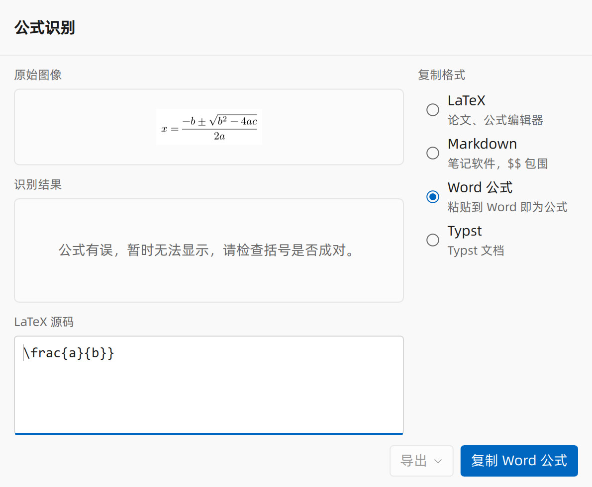
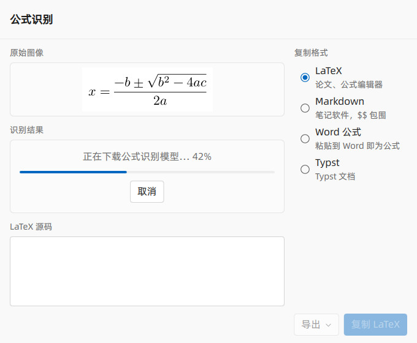

# 公式识别 验证记录（2026-11-26）

截图、贴图或编辑窗口里按 `Shift+F`（或点“公式”），打开“公式识别”窗口：原始图像、识别结果、可改的 LaTeX 源码，按 LaTeX / Markdown / Word 公式 / Typst 复制，导出图片。分支 `formula-ocr`。

## 识别准确度（Pix2Text MFR 1.5，C++ 读法）

- 语料 480 张：40 个公式 × 3 种字体（matplotlib 的 Computer Modern、STIX、DejaVu Sans）× 2 种字号（16、24 px）× 浅底 / 深底，按屏幕截图的样子渲染。`tst_formulareader corpus`（设 `WINSHUN_FORMULA_CORPUS`）逐张读，按结构比对：**405/480 读对**。
- 把握度：≥ 0.9（`FormulaReader::kSure`）的 472 张读对 402 张；< 0.9 的 8 张只对 3 张，窗口对这些写“可能不准确，请对照原图检查”。
- 预处理与 Python 参考实现逐字节一致（`preparesAsPillow`：反色、裁边、Pillow 双三次缩放到 384×384）。
- 速度：二次公式 213×72，冷启动 837 ms（其中加载模型 509 ms），把握度 1.000；模型空闲一分钟后卸载。

## 复制格式

- **Word**：52 个公式（`tst_formula dump` 的全部用例）经剪贴板粘进隐藏的 Word（自动化启动，测完退出），**52/52 各成为一个公式**。Word 认纯文本里的 MathML、注册格式 `MathML` 和 `MathML Presentation`；只给 `application/mathml+xml` 时 Word 拒绝粘贴，所以产品只写前三种。
- **Win+V 历史保护**：测试写的剪贴板数据都带 `ExcludeClipboardContentFromMonitorProcessing`、`CanIncludeInClipboardHistory=0`、`CanUploadToCloudClipboard=0`；历史条数前后都是 25，测完把最新一条放回剪贴板。
- **Typst**：同样 52 个公式的 Typst 输出用 Typst 编译器（typst-py）逐个编译，**52/52 通过**。
- **Markdown / LaTeX**：`--preview-formula` 核对 Markdown 以 `$$` 换行包住，LaTeX 与识别结果一致。

## 界面（离屏预览，真实模型）

`WinShunCapture.exe --app-dir <Win顺> --preview-formula <目录> --components <含模型的目录> --ocr-dir <构建目录> [--dark] [--english] [--scale N]`，状态依次为：缺模型、下载中、下载失败、识别中、识别完成、复制 Word、源码有误、图中没有公式。四组（浅色 100%、深色 150%、英文 125%、浅色 175%）全部校验通过；唯一的警告是已知的“Window frame: new native handle”。

| 识别完成（浅色 100%） | 复制 Word 公式（深色 150%） |
|---|---|
|  |  |
| **缺模型（英文 125%）** | **源码有误（浅色 175%）** |
|  |  |

下载中（浅色 100%）：

## 按键与接线

- `--preview-capture-tools <目录> --selection-keys`：真实截图遮罩（全屏夹具窗口，真实抓屏），按键事件直接发给遮罩窗口：`Shift+F` 把选区的像素与它在屏幕上的物理位置原样交给公式识别，截图随即关闭；其余 R / WASD / 方向键 / 文字输入等原有检查照常通过，0 警告。
- 单元测试（只跑相关的）：`tst_capturekeys`（贴图默认 `Shift+F` 并能触发识别公式）、`tst_pinwindow`（按键卡片多了“识别公式”）、`tst_capturesettings`（工具条按钮 id 含 `formula`）、`tst_ocrpackage`（公式模型逐个文件换源、校验不符、断网、取消、手动下载的文件夹安装、移除、缺运行库时先装增强识别）、`tst_formulareader`、`tst_ocr`、`tst_formula`（括号不配对时报错、未闭合时仍能画）：7/7 通过。

## 没做的

- 没有在运行中的 Win顺 里用真实键盘、鼠标走一遍 `Shift+F`（按键夹具用的是发给遮罩窗口的事件，不经系统输入）；也没有在贴图右键菜单上实点。
- 没有测 WPS、OneNote 等其他程序对 MathML 的粘贴，文档只承诺 Word。
