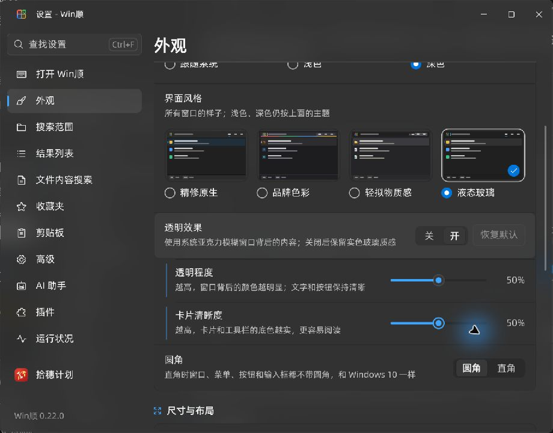
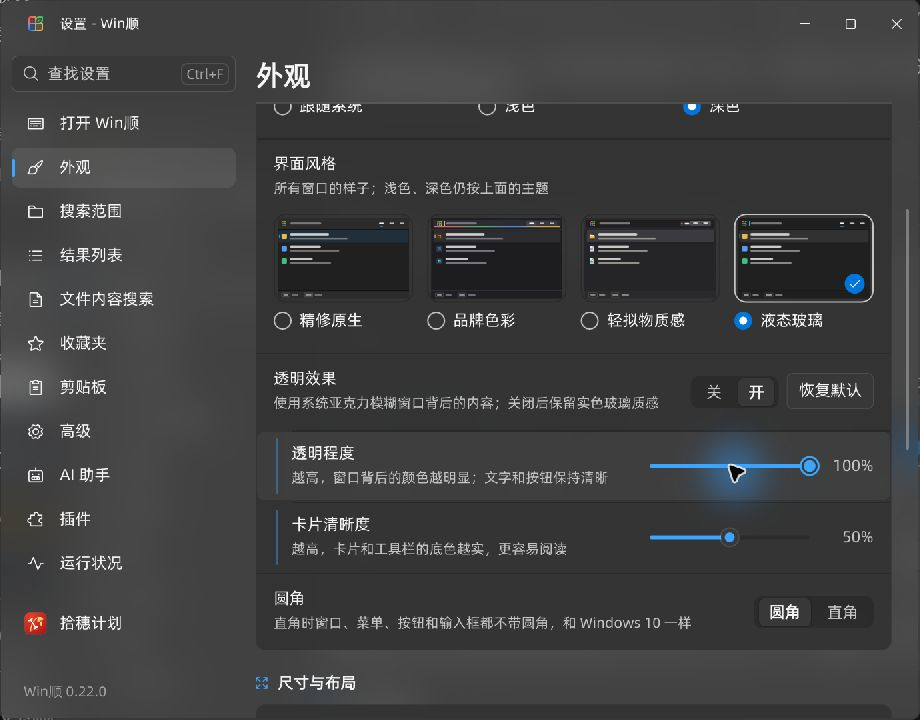
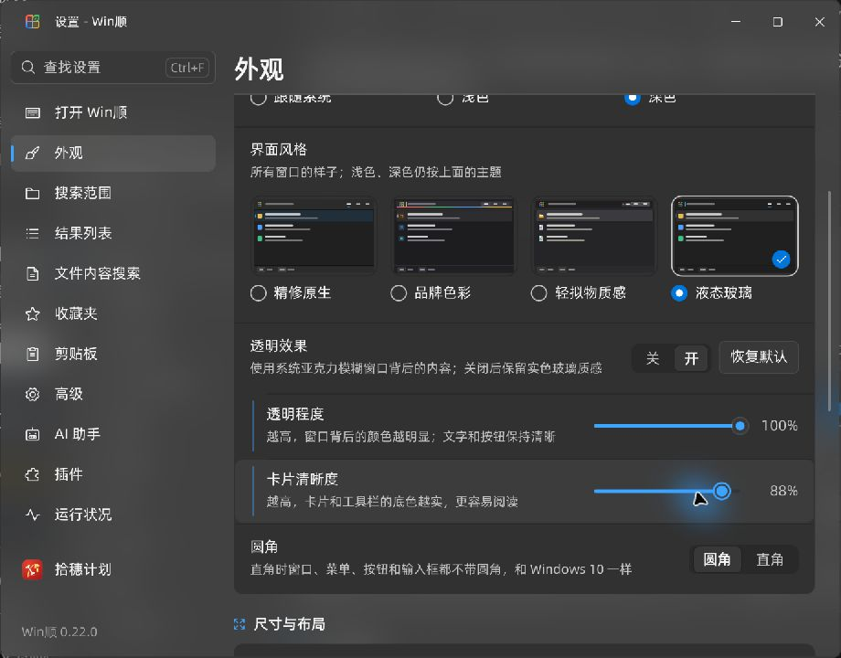
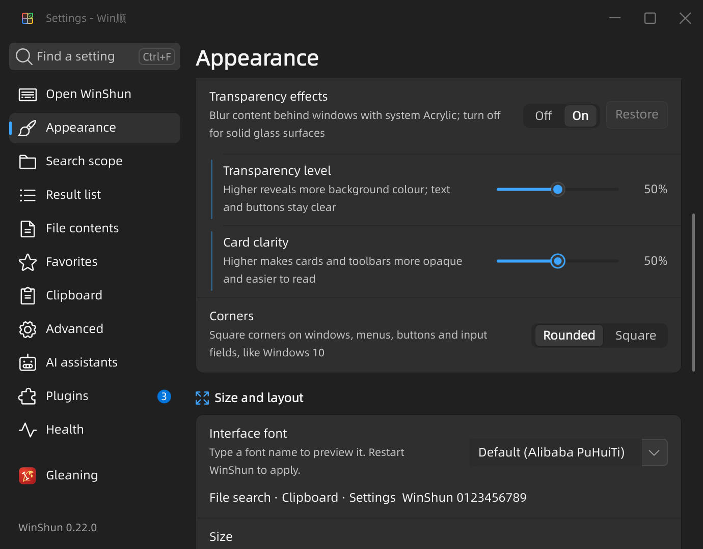

# 液态玻璃参数验证

2026-11-07，Windows 11，Qt 6.12.0 / MSVC 2022 x64 Release，D3D11。验证当前包含其他未提交修改的工作区；没有提交、推送或发布，没有替换用户正在运行的程序。

## 实现

液态玻璃开启透明后，显示“透明程度”和“卡片清晰度”两个参数及“恢复默认”。透明程度调整窗口底色遮罩；清晰度调整卡片和工具栏底色。两项都是 0–100 的相对强度，中点 50 保留原有浅深色配比，不把文字和按钮整层淡化。菜单保持实色，关闭透明或系统禁止材质时保留实色回退。其他风格不显示这两个参数。

滑块采用原生 Qt Quick Controls 的输入与无障碍接口，补齐 Home/End，支持方向键。拖动通过 SystemTheme 即时预览；松手后才保存。Settings / SettingsEditor / AI 设置目录均包含新参数；主程序、剪贴板显示进程、拖放圆盘及截图/OCR 窗口接入外观同步。插件业务全流程和生产 UIAccess 服务没有在本轮重新实测。

当前 DWM 材质接口提供的是材质类型选择，没有本项目可直接使用的模糊半径或噪点参数。本次继续使用系统模糊；[官方接口](https://learn.microsoft.com/en-us/windows/win32/api/dwmapi/ne-dwmapi-dwm_systembackdrop_type)。

## 结果

- 主程序、`WinShunCaptureApp`、`WinShunOcrSearchApp` 构建成功。构建记录见 `build-input.log`、`build-shared.log`。保留工作区已有的 Qt 生成代码 C4702 与探针局部变量 C4456 警告。
- [四档 DPI 外观检查](appearance.txt) 100%/125%/150%/200% 全部通过。新用例覆盖默认值、保存重载、越界夹取、背景参数单调变化、卡片参数独立变化、文字颜色不变和关闭材质后的实色回退。已有桌面截图 opt-in 用例仍为跳过，不能计为通过。
- [AI 设置针对性检查](ai.txt) 30 个用例通过，覆盖两项设置的 0/50/100 保存重载，以及拒绝 -1/101。
- 实际 `SettingsWindow` 探针：浅色中文 100%、深色英文 150% 各 23 项检查通过，均为 0 QML warning。包含进程内真实鼠标按下/移动/松手、拖动中外观变化但配置不写入、松手保存、方向键/Home/End、无障碍名称与角色、恢复默认、760/920 宽度、关闭后隐藏以及切换 Mica 风格后隐藏。见 `ui-input.json`、`ui-dark-english.json` 与同名日志。
- 新增 CTest 入口 `tst_glass_controls_light`、`tst_glass_controls_dark_english`；本轮执行了等价 CLI，已配置并确认 CTest 注册。
- 独立真实桌面预览：用 Computer Use 点击透明滑块并按 End，画面为 100%，隔离配置同样保存为 100；拖动清晰度到 88，画面、无障碍值和隔离配置一致；点击恢复默认，画面和配置均回到 50/50。截图直接保存原始 JPEG。没有使用用户配置或中止用户程序。

初轮键盘探针暴露了 Home/End 尚未支持的问题，随后补齐并通过；初轮运行时缺少 SVG 插件路径，也已在验证环境修正。失败原始日志保留在任务构建目录，不把它们计为通过。

## 截图与产物

构建复用 `build/ui-preview`，任务日志和诊断原始材料集中在 `build/glass-controls-20261107/`。真实预览 PID 20336 已正常退出。退出时出现既有 watcher 清理警告，见 `native.log`；临时 profile 的剪贴板数据库残留于 `build/glass-controls-20261107/temp/WinShun-preview-54a80368/`。该目录保留为清理失败诊断原件，未改用其他机制绕过此前的删除策略拒绝。

本轮主程序 SHA256：`C7C9E52262EFE7FC07BB9FB50D2B4517E260C205C437954444A9A21D048ADF8A`。它对应含其他改动的工作区，不是独立提交的构建证明。
