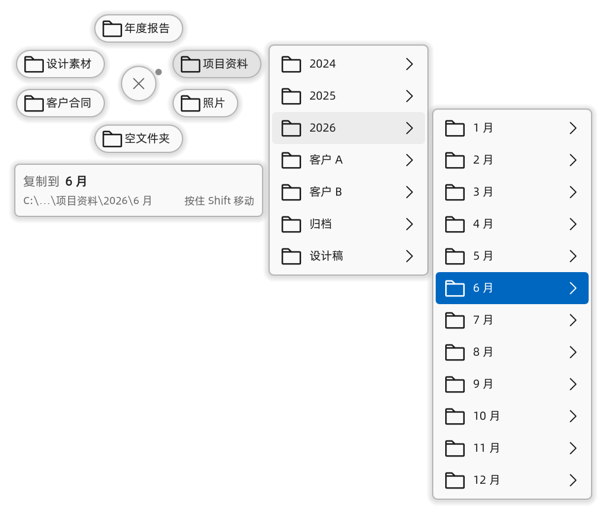
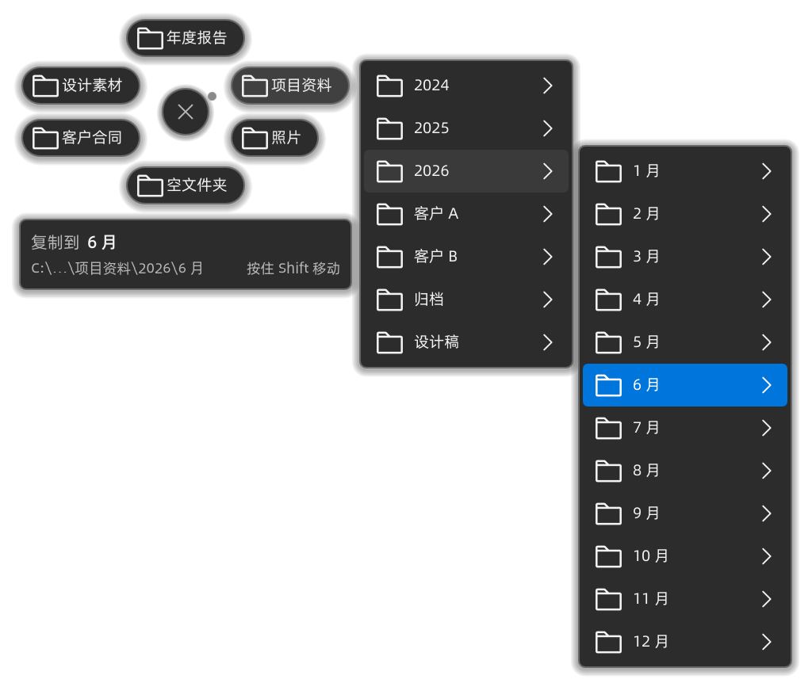
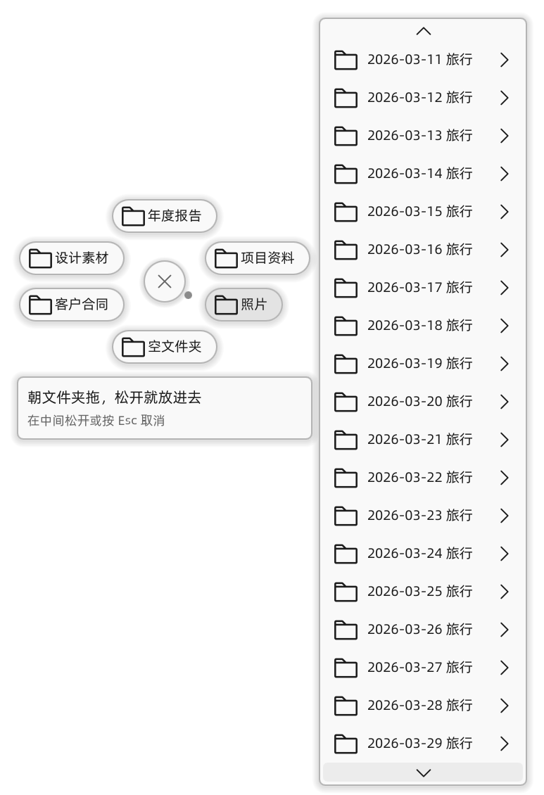

# 收藏圆盘逐级展开子文件夹（GitHub #463）验证

2026-11-25，本机 Windows 11，Qt 6.12.0，`build\release`。

## 自动检查

- `ctest -R ^tst_piegeometry$`：通过。新增 `columnBeside`、`columnScrolls`、`columnHits`（列的位置、翻边、贴边、滚动条带与命中）、`aimTriangle`（菜单瞄准三角）、`hullBetween`（来处与列之间的凸包）。
- `WinShun.exe --preview-results <dir> --drop-pie-columns --renderer d3d11 --scale <s>`，`s` = 1、1.25、1.5、1.75 及 1.5 `--dark`：全部 `drop pie columns: passed`。
  - 出图部分：右侧一列、两级、左侧一列、超长列滚动、空文件夹，检查行序（2 在 10 前）、紧贴胶囊、避开下方说明行、在屏幕内、目标行与“复制到 …”说明一致。
  - 拖动部分：用圆盘自己的 DragOver 路径（`DropPie::previewPointer`）模拟每次移动一次、静止时每 50 ms 一次，真实计时与后台读文件夹：快速划过不展开；停 350 ms 展开；斜向奔向下方行时穿过相邻胶囊方向而不切换（菜单瞄准）；停在行上松开为复制；停在行上展开下一级；瞄准途中停在另一行超过 150 ms 后改选该行并换成它的列；回到中间收起全部；停在下方条带向下滚动、上方条带滚回；停在胶囊稍外侧、列出现在指针下时胶囊仍是目标，挪动后才选中列里的行；离开范围即收起。
- `--drop-pie-pages`、`--style-windows`（含文件夹菜单，`MenuHighlight` 抽成共用文件后）在 1.5 下仍通过。

## 修掉的问题

- 100% 下的拖动检查发现：从胶囊斜着去一列很高的列底部时，路径经过圆盘下方、列左侧的空隙，两边的“附近”范围都不覆盖，圆盘会直接收起。现把来处与列之间的凸包也算作仍在圆盘上（`pie::inHullOf`）。
- 自查发现：停在胶囊稍外侧（仍在圆盘范围内）时，展开的列正好出现在指针下，原先“未移动前什么都不选”会让胶囊失去选中，松开就什么都不做。现改为列出现在静止指针下时保持原选中，移动后才按列里的行算（有检查）。
- 自查发现：瞄准途中松开时，`drop()` 先清掉瞄准状态再取指针下的对象，会放进与说明行不同的文件夹。现按说明行显示的目标放。

## 截图（150%）

| 两级展开，目标行与来处行 | 深色 | 超长列滚动 |
|---|---|---|
|  |  |  |

## 未做

没有用真实的资源管理器拖动实测：那需要退出正在运行的 Win顺。交互逻辑已由上面模拟 DragOver 的检查覆盖；OLE 本身的收发与原来一样未改。
