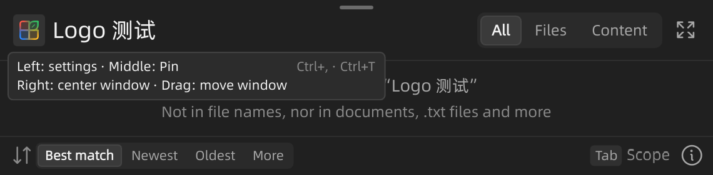

# #162：搜索栏 Logo 合并入口

> 后续调整（2026-11-02）：外侧装饰 Logo 和开关已退休，见[移除记录](../remove-edge-logo-20261102/README.md)。本页保留当时的实现及验证，不代表当前装饰窗口行为。

> 2026-11-02 补充：本页原验证覆盖主搜索框和搜索面板，遗漏了独立的对话框旁搜索组件。用户截图指出后，已补齐栏内程序 Logo，并在当前完整源码的新构建中验证；见 [对话框补充验证](../dialog-search-logo-20261102/README.md)。对话框仍保持原有菜单和附着行为，不套用主搜索窗口的固定、居中操作。

2026-11-01，Windows 11 x64，Qt 6.12.0 / MSVC 2022 Release，D3D11。

## 行为

- 搜索框和搜索面板共用栏内矢量 Logo，删除启动器外侧装饰和独立图钉。左键设置，中键钉住，右键居中，左键拖动仍交给 Windows；保留 Ctrl+T。
- 固定状态由 `Launcher::pinned` 单一来源驱动背景、图钉角标、说明和底栏。提供可访问名称、说明和键盘激活，悬停列出全部操作。
- 原生句柄按 `Qt::MouseButton` 上报；中键/右键必须有匹配按下，移出、取消、隐藏或越过系统 DPI 对应拖动距离时不触发。
- `Placement::centerOnScreen()` 使用窗口当前显示器的可用区域，保留尺寸和内容，解除临时附着；搜索框和面板分别记住位置。居中按整像素对齐，位置断言只允许两轴合计最多两个逻辑像素误差。
- 外观开关保留 `Appearance/SearchLogo` 配置键，改称“窗口边缘显示 Logo”，继续控制剪贴板和对话框旁的装饰；搜索栏操作入口始终保留。同步 AI 设置描述和中英文文档。
- Logo 直接来自内置 `resources/logo.svg`，不依赖异步 Shell 图标提取。打包脚本补充 `qsvg` 解码器。

## 验证结果

| 检查 | 结果 | 证据 |
|---|---|---|
| 中文浅色，缩放参数 1.0，真实 Main/WindowFrame/Placement | 38 项通过，0 运行时警告 | [JSON](zh/search-logo.json)、[日志](zh/preview.log) |
| 英文深色，缩放参数 1.5，同一生产组件 | 38 项通过，0 运行时警告 | [JSON](en/search-logo.json)、[日志](en/preview.log) |
| 搜索导航、IME、预览现有回归 | 通过；导航 118 项、对话框列表 23 项，0 运行时警告 | [日志](navigation.log) |
| `tst_displaygeometry`、`tst_aisettings` | 通过 | [相关 CTest](ctest-related.txt) |
| `tst_searchlogo` 独立 CTest | 通过 | [最终 CTest](ctest-logo.txt) |
| 隔离部署，移除 Qt 开发目录的 PATH/插件入口 | 同一 38 项通过，0 运行时警告；部署中有 qsvg.dll 和 Qt6Svg.dll | [JSON](deployment/search-logo.json)、[日志](deployment/preview.log) |
| 构建与脚本 | WinShun / tst_displaygeometry / tst_aisettings 构建通过；PowerShell 打包脚本语法解析无错误；相关 diff 无空白错误 | [构建日志](build.log) |

专用检查覆盖三种原生按钮消息、连续中键、无按下的抬起、移出松手、超出拖动阈值后返回、键盘激活、固定状态回显、查询及焦点保留、当前屏居中及尺寸保留、完整提示绘制。几何测试还覆盖临时附着解除、重新打开后的持久化和搜索面板独立位置。

相关 CTest 日志保留了一次早期 `tst_searchlogo` 失败：悬停探针最初没有管理真实鼠标的自动离开消息，且面板探针命中了隐藏搜索框遗留的同名提示对象。修正测试的局部事件管理和对象身份后，独立 CTest 和两组 UI 检查均通过；该次日志中的其他三个测试已经通过。没有把早期整组运行记为全通过。

## 画面




## 复现和证据边界

```powershell
ctest --test-dir build/search-improvements-20261101/bin -R '^tst_searchlogo$' --output-on-failure
build/search-improvements-20261101/bin/WinShun.exe --preview-results build/issue162-ui-150-en --search-logo --renderer d3d11 --scale 1.5 --english --dark
```

复用基于 `07f9d3d5065a1e189a0c631cf003786aecc4fefd` 的隔离源码/构建，按本次变更逐项更新。工作区同时有窗口外观、Web 搜索等并行修改；隔离副本没有引入这些尚在变动的整体集成内容。其中 `WindowFrame.cpp` 保留本次完整行为，仅排除了并行窗口模块的 `prepareFramelessWindow` 调用；共享 App/QML 文件只移植本次相关改动。不能将上述结果解释为当前所有未提交修改的整体构建验证。文件及关键实现片段指纹见 [source-fingerprints.json](source-fingerprints.json)。

测试使用临时数据和发送到自有测试 HWND 的本地 Win32/Qt 事件，没有发送全局鼠标/键盘输入，没有打开外部文件或修改用户配置。悬停检查取消测试 HWND 的真实光标离开跟踪，并自行发送离开事件；它验证原生事件到实际提示的链路，不是物理鼠标操作的证明。真实拖动跨不同 DPI 显示器、Windows 10、辅助技术读屏尚未实机验证。设置动作验证到既有 `settingsRequested` 信号，`App::showSettings` 的生产连接已核对。

独立部署按打包脚本的依赖裁剪参数运行 windeployqt，再复制脚本所列 qgif/qjpeg/qsvg；通过本地 qt.conf 和子进程环境移除 Qt SDK 的 DLL/插件搜索入口。它验证此功能在裁剪后 Qt 依赖中的运行，不代替完整安装程序/便携包的发布验收。原有用户程序保持运行，本次没有提交、推送、关闭 Issue 或发布版本。
