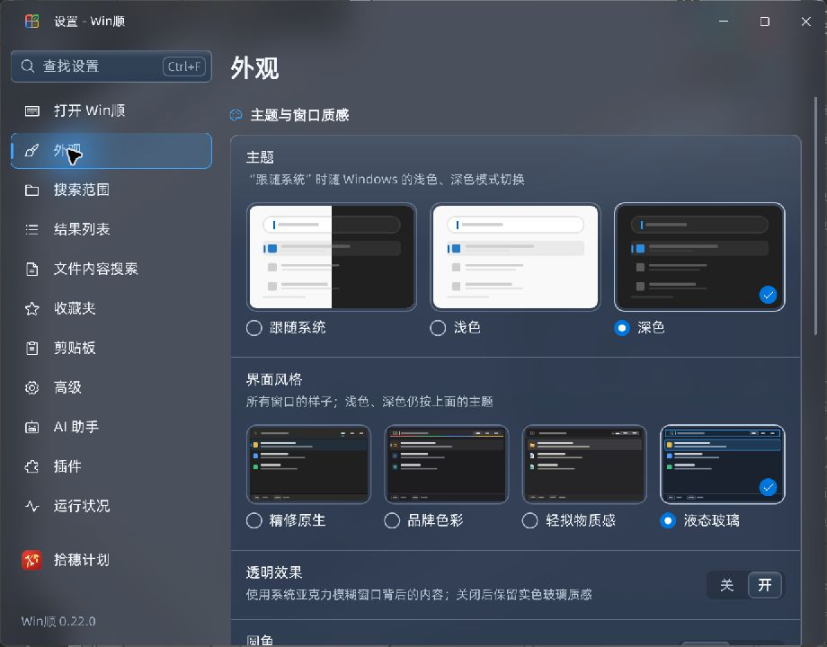
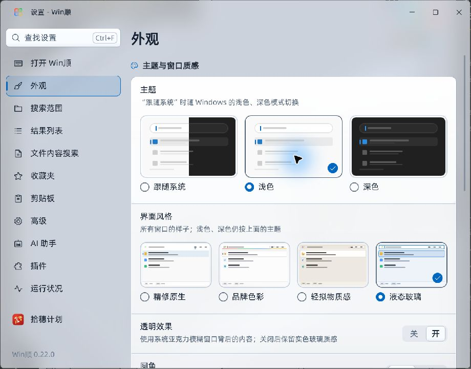
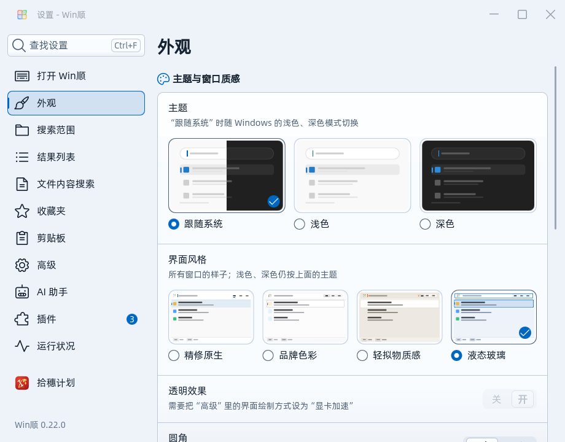
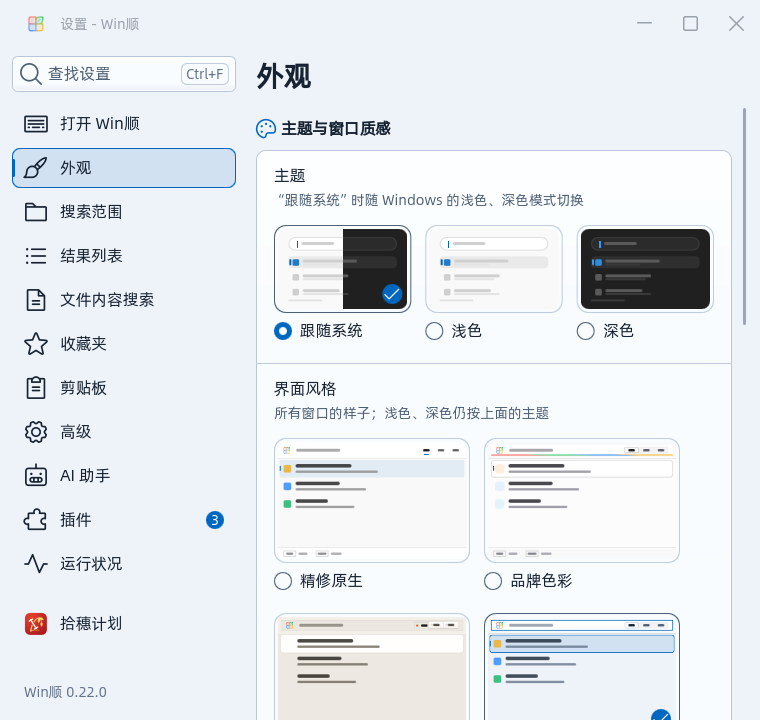
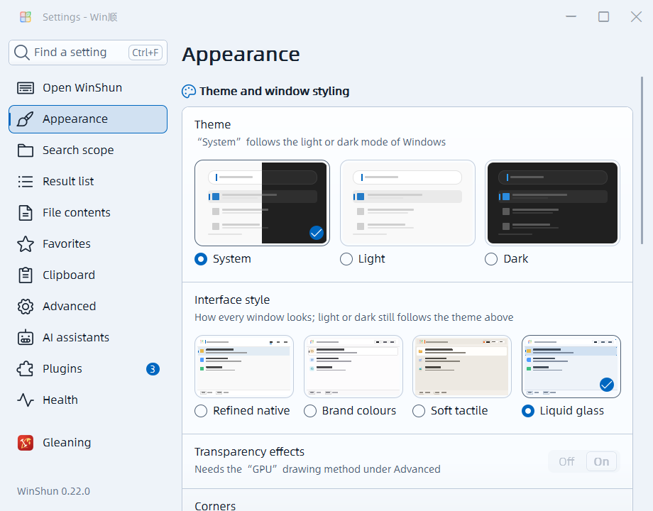
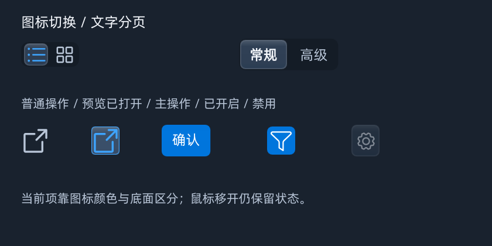
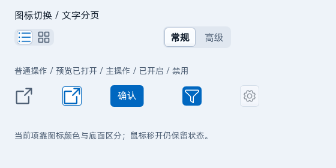
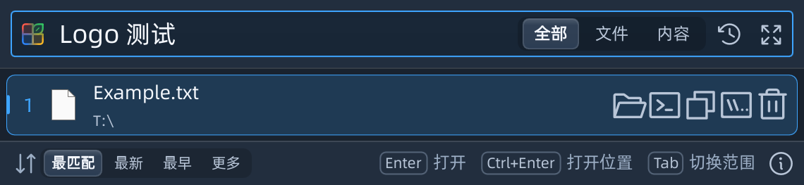
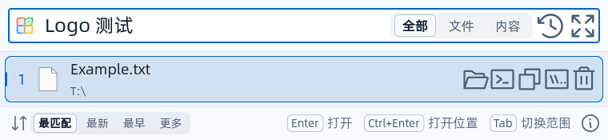

# #235 液态玻璃主题验证

2026-11-07，Windows 11 Pro 10.0.26200，Qt 6.12.0 / MSVC 2022 x64 Release。基于 `c4381dd` 的当前工作区，包含原有未提交修改；未提交、推送或发布。最终程序校验值见 [environment.json](environment.json)。

## 结果

| 验证 | 结果与边界 |
| --- | --- |
| 主程序与共享主题插件构建 | `WinShun`、`WinShunCaptureApp`、`WinShunOcrSearchApp` 均成功；插件运行时未单独做全流程验证 |
| 原生背景 | `liveBackdropSwitch` 读取真实 HWND 的 DWM 属性，验证 liquid 为 3、其他风格为 2、实色窗口为 1，已有窗口、新窗口和退出背景注册均正确 |
| QML 部件与回退 | 13 个钩子，浅深色 × 圆角/直角 × 背景可用/实色，创建与实时状态变化均通过；QML warning 视为失败 |
| DPI | 100%、125%、150%、200% 的 `tst_appearance` 全部通过；其中桌面组合截图用例属于显式 opt-in，本轮未启用，不能计为已通过 |
| 真实控件 | light / dark / square 的按钮探针通过，包含实际鼠标切换列表/大图、打开预览状态、主操作白字、禁用时整体变淡和键盘焦点 |
| 设置选择器 | 760、920、1080 窗口宽度，窄窗口两列、默认/宽窗口四列，鼠标与方向键、Enter/Space、保存后重新加载通过；包含单选角色、名称及选中状态的可访问性检查 |
| 菜单 | liquid 的圆角、直角下拉菜单探针均通过，覆盖控件旁间距、边框、padding 和 delegate 宽度 |
| 原生绘制兼容 | `tst_traymenu nativeLook styledRows countdown`，四种风格的 50 个用例通过 |
| AI 设置 | 针对性检查 30 个用例通过，包含 `Appearance/UiStyle=liquid` 经计划校验、保存和重载 |
| 启动器 | light / dark 的 `--search-logo` 各 123 项检查通过，0 QML warning；截图为生产 Main/Launcher 配合临时样例数据，不是用户索引的端到端搜索结果 |
| 英文与软件回退 | 英文 `--style-picker --renderer software` 通过，0 warning，检查三档窗口宽度及保存、键盘/鼠标选择 |
| 真实桌面观感 | 独立 `--probe-runtime --live`，真实 D3D11 窗口，查看浅深色 Acrylic、四张风格卡片与文字层级；没有退出用户现有 Win顺 |

## 记录与复现

- [最终控件与四档 DPI](final-controls.txt)、[选择器](picker-accessibility.txt)、[菜单及初轮主题界面](liquid-ctest.txt)、[原生绘制](native-look.txt)、[AI 设置](ai-settings-targeted.txt)。
- `picker-*.json`、`buttons-*.json`、`search-logo-*.json` 保存具体断言结果。
- [原始离屏截图归档](screenshots-originals.zip) 保留各探针的 PNG、JSON 和日志；下面图片便于直接查看。离屏截图不能证明桌面背景模糊，原生材质另用真实窗口观察和 HWND 属性检查。

```powershell
cmake --build build/ui-preview --target WinShun tst_appearance tst_traymenu tst_aisettings WinShunCaptureApp WinShunOcrSearchApp --parallel 8
ctest --test-dir build/ui-preview --output-on-failure -R '^tst_(liquid|combopopup_liquid|appearance_)'
build/ui-preview/tst_traymenu.exe nativeLook styledRows countdown
build/ui-preview/tst_aisettings.exe tableIsSound writableRoundTrip liquidStyleChoice boundariesAreAccepted invalidValuesAreRejected
```

## 已知情况

- 额外跑完整 `tst_aisettings` 时，155 个用例通过、1 个既有用例失败：`rowTitlesExistInTheSettingsWindow` 中 `Launcher/History` 的标题为“记住打开过的项目”，实际设置页为“记住搜索和打开过的项目”。两处差异在 `HEAD` 中已存在，与本次主题改动无关，未修改。原始记录见 [ai-settings.txt](ai-settings.txt)，不能声称整个 AI 设置套件全绿。
- 构建仍有 Qt 生成代码 C4702，以及已有下拉菜单验证块的局部名称 C4456 警告；没有编译错误。
- live 探针退出清理临时 profile 时，原有 `QFileSystemWatcher` 报 components 目录访问失败；发生在窗口验证结束、profile 清理时。本轮不将其当成主题绘制失败。探针进程已退出；后续对本轮残留目录的清理被自动审批以 `blocked by policy` 拒绝（包括核对后使用明确绝对路径的重试），临时目录仍保留，详见 [清理状态](cleanup.txt)。
- 本轮未在 Windows 10 实机、省电模式、高对比度环境做原生测试，未测量耗电或承诺帧率。软件渲染与实色回退已测试。设计取舍见 [设计文档](../../design-liquid-glass.md)。

## 截图

真实桌面合成后的窗口：




默认宽度与较窄窗口的实色回退（离屏）：




英文与软件绘制（离屏）：



真实控件与启动器样例（离屏）：





