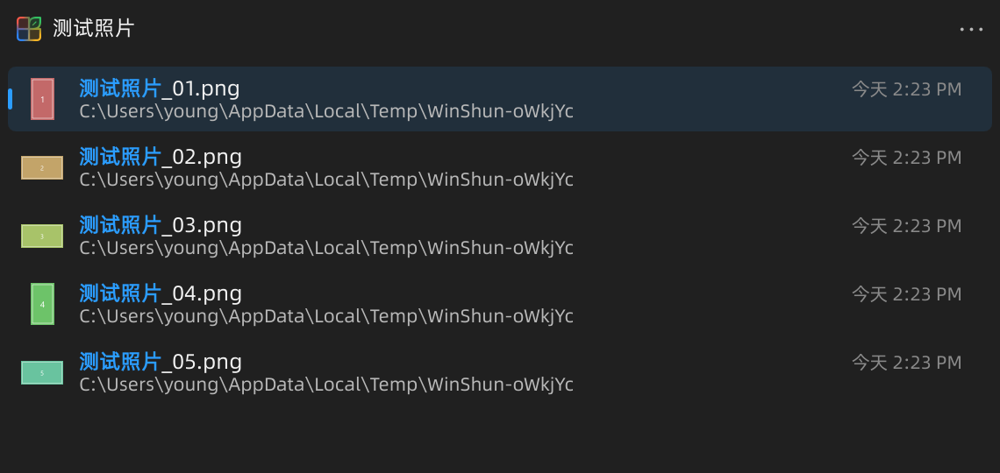

# #245：文件夹搜索双行结果间距

2026-11-07，Windows 11、Qt 6.12.0、MSVC 2022 x64 Release，D3D11。用户明确第 2 项“设置 → 打开 Win顺”已经修复，本次只处理第 1 项，不重做下拉菜单。

## 原因与调整

反馈截图的双行结果来自 `DialogBarWindow` / `DialogBarRow`。名称和路径原来使用字体默认 Windows 行度量；默认字体的行框较高，压缩了各结果之间的留白。当前生产组件实测，标准行高 52，两个文本行及内部间距总高约 45.33，只剩约 6.67 的外部留白。

名称与路径改用 Qt 6.8 起提供的 `font.preferTypoLineMetrics`。它使用字体排版度量，让两行组成更紧凑的整体；标准行的外部留白实测为 20。字号、条目行高和点击区域没有变化，没有通过裁切文字或放大整个列表处理。

官方说明：[Qt Text 的字体排版度量](https://doc.qt.io/qt-6.8/qml-qtquick-text.html#font.preferTypoLineMetrics-prop)。字体有不同的 Windows 与排版度量，默认 Windows 度量可能比适合排版的行距更大。本次验证针对当前默认字体，不代表所有自定义字体都已测试。

## 验证

- 主程序构建通过，见 [build.log](build.log)。保留原有 Qt 生成代码 C4702 和既有下拉菜单探针局部变量 C4456 警告。
- 扩展已有 `--search-navigation` 探针，通过生产 `DialogBarWindow`、`DialogBar` 和真实临时索引结果测量三档字号。检查每项文本上下留白、条目间距并保存截图，同时运行原有搜索、方向键、Ctrl 导航、菜单和 IME 检查。
- 浅色 125%、深色 150% 各 35 项对话框检查通过；整个搜索导航探针均返回 0、0 QML warning。具体断言见 `dialog-light.json`、`dialog-dark.json`，完整日志见 `preview-*.log`。本轮没有使用原生文件管理器注入全局输入，不能据此宣称原生对话框全流程重测。
- 外部留白（逻辑像素）：125% 紧凑 15.6、标准 20、宽松 23.6；150% 分别为 16、20、24。两行之间的间距保持 2。
- 初始测量保存于 `before.json` 与 `before-standard-150.png`。最终检查增加了至少 4 的上下留白要求；历史初始检查较宽松，不把它描述为失败后通过的完整测试记录。
- 构建复用 `build/ui-preview`，本任务探针与中间截图放在 `build/issue245/`。该目录保留定位原始截图、前后测量及不同处理方式的诊断证据。没有启动 live 探针；普通探针自行回收临时配置。没有停止或替换用户正在运行的实例，没有提交、推送或回复 Issue。
- 工作区含其他任务的未提交和已暂存修改，本次未改变它们的暂存状态。

