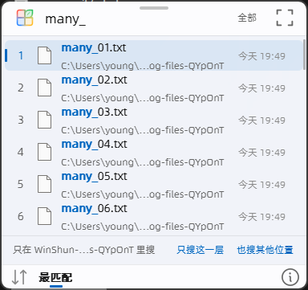

# 2026-11-10：#227 索引保存的内存峰值、#265 负载高时呼出慢、#246 文件夹内搜索的范围选项

分支 `issues-227-265-246`，三个提交：a043079（#227）、a8c3645（#246）、85b40ed（#265）。Qt 6.12.0 / MSVC Release。只跑了本次涉及的测试，没有跑全量 ctest。

## #227 后台保存索引快照时临时多占内存

快照仍是 v9 格式，名字表和条目都和原来逐字节一致；改的是保存时怎么给名字编号。原来每个名字都进一张编号表，现在先扫一遍名字块，只给出现两次以上的名字编号（位图 + 秩目录），其余名字按出现顺序直接写出。

`wsbench --resave`（每 1 ms 采样 PrivateUsage，记录保存期间比索引本身多占的私有提交）：

| 索引 | 修改前 | 修改后 |
|---|---|---|
| 合成 3000 万条，名字各不相同 | +1143 MB，8.3 s | +211 MB，1.9 s |
| 本机真实索引 349 万条 | +70 MB，578 ms | +44 MB，350 ms |
| 合成 300 万条，名字大量重复 | +32 MB，142 ms | +32 MB，172 ms（多扫一遍名字块） |

三种情况重新保存后的文件和原文件相同，读回的条目数一致。`tst_core` 新增 `snapshotNamesSharedAndOwn`，覆盖共享名、同字不同存的名字、删除项、移到后建文件夹的项，以及读回后再保存得到相同文件。按报告者的 1.8 亿条估算，保存时仍要多占约 1.06 GB，主要是每个槽位 4 字节的新编号表；文件夹表和内容索引附件还要用它，这次没动。

## #246 只搜当前文件夹时，范围选项要滑到底才看得到

“只在 X 里搜 / 只搜这一层 / 也搜其他位置”原来是列表最后的两条提示，结果一多就被挤到看不见。现在固定成列表和底栏之间的一行（`ScopeBar.qml`），列表末尾不再重复；没有结果时，空状态仍照旧列出它们。

`WinShun.exe --probe-runtime <目录> --folder-typing`（真实 App、真实 QML、新开的资源管理器窗口）新增 40 个 `many_NN.txt` 和 5 项检查：结果超过框能显示的行数时，范围栏在窗口内、不用滚动；列表末尾不再有这两条提示；点“也搜其他位置”后变成搜全部、范围栏消失；之后查询恢复。最终版本 47 项检查全部通过，0 警告。截图：

## #265 系统负载高时呼出慢

### 实测方法

在 Program Files 版的副本里，用同一份临时配置（只索引 C:\Windows，关闭内容索引）分别运行修改前（main，search-gray 构建）和修改后的程序。测试工具（[ab.cs](ab.cs)）用 SendInput 按真实快捷键 Ctrl+F22（或双击 Shift），以高优先级每 1 ms 检查窗口是否已经去掉隐藏、出现在屏幕上，记录从按键到看见的时间。原始数据见 [ab-265.txt](ab-265.txt)。

### 内存被挤出（已改进）

先用 EmptyWorkingSet 清空 Win顺 的工作集（相当于 Windows 在内存紧张时做的事），再以管理员身份刷新修改页列表、清空备用列表，下一次呼出就要从磁盘读回约 9000 页。现在呼出窗口后，会记下这次用到的页（最多 256 MB，优先留零散的小段），下次按键时用 PrefetchVirtualMemory 让 Windows 一次性成批读回。

| 轮次 | 修改前 | 修改后 |
|---|---|---|
| 第 1 轮（含后来移除的提速代码） | 220 / 214 / 193 ms | 101 / 107 / 102 ms |
| 第 2 轮（同上） | 148 / 167 / 142 ms | 107 / 104 / 104 ms |
| 最终版本 | 152 / 146 / 145 ms | 90 / 107 / 96 ms |

这台机器用的是 SSD；机械硬盘或磁盘本来就忙时，一页页读回会慢得多，提前成批读的收益应更大，但这次没在机械硬盘上测。不缺内存时，呼出时间不变（27–50 ms，前后一致）。

### CPU 负载（未能改进，原因已查明）

- 64 个普通优先级的忙线程占满 32 个逻辑处理器：修改前后都是 25–62 ms，没有变慢，Windows 自己的调度提升已经够用。
- 64 个“高于正常”优先级的忙线程：修改前后都常在 520 ms 左右。Win顺 自己的日志显示，时间几乎全花在把窗口带到前台（front_ms 约 505–519 ms）。
- 单独实验（[fg.cs](fg.cs)，不涉及 Win顺）：同样负载下，窗口里没有文本框时，SetForegroundWindow 只要 5 ms；有文本框时，SetForegroundWindow 和 SetFocus 各要等约 500 ms，但前台在 1–3 ms 内就已切换。等待来自 Windows 的文本输入框架：焦点移动时它要等输入法自己的进程，而那个进程在这种负载下抢不到 CPU。
- 试过临时把界面线程和绘制线程提到最高、再提到实时关键，并把快捷键改由独立的高优先级线程接收，三轮实测（快捷键两轮、双击 Shift 一轮）都没有可量的改善，所以没有提交这部分代码。

结论：本次只提交内存部分。“高于正常”优先级的程序占满所有核心时，仍会有约 0.5 秒的等待，这是 Windows 输入法框架的行为，Win顺 这边无法缩短。

## 现场安全

每轮实测前取得 `F:\wswt\ui.lock`，通知其他会话；退出 Program Files 版，测完以普通权限重启它，并核对自启动任务和三处“用 Win顺 搜索此处”右键项仍指向 Program Files。清空备用列表会让系统文件缓存暂时变冷，每轮只做 3 次。
