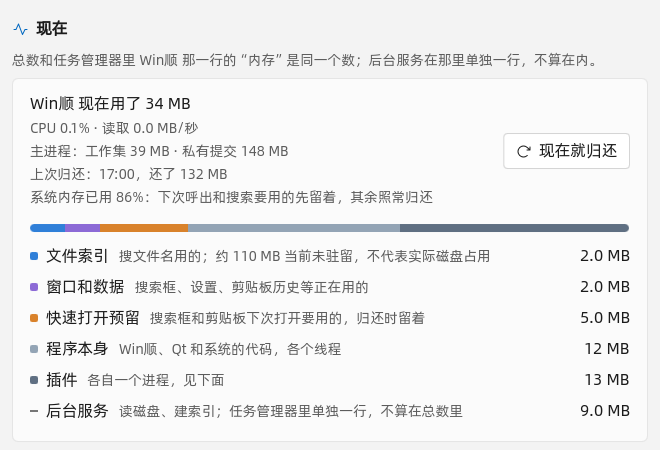

# #430 在文件夹里打字开终端仍开在程序目录；#500 内存紧张时内存一直不归还

2026-11-27，本机（Windows 11 26200，32 GB，NVMe，150% 缩放，独显），`build\release`。

## #430：0.51.0 只改了“应用”那一行

反馈者更新到 0.51.0 后，在资源管理器里打 `pwsh` / `cmd` 按 Enter，终端仍开在程序自己的目录。截图里窗口标题是程序路径、带启动横幅、当前目录是 `C:\Program Files\PowerShell\7`：这是直接启动 `pwsh.exe` 这个**文件**的样子。索引四百万个文件时，列表里排在前面的常是程序文件那一行，而 0.51.0 只在“应用”那一行（`performApp`）判断终端，文件行走 `perform` → `shell::open`，工作目录是文件所在目录。

改动：

- `Launcher::terminalTypedIn` 一处判断，应用行和文件行（`cmd.exe`、`powershell.exe`、`pwsh.exe`、`wt.exe` / `WindowsTerminal.exe`、`git-bash.exe`、`wsl.exe`）共用；`openTerminalTypedIn` 负责打开，`Enter` 与 `Ctrl+Shift+Enter`（管理员）都走它。
- 找到哪个程序就开哪个（`shell::openTerminalProgram`）：第二份 PowerShell 7、便携版 Git 的 `git-bash.exe` 不再换成“已安装的那个”或退回 cmd；命令提示符仍用系统的（共享目录要 `pushd`），Windows 终端仍走已安装的那个（包里的程序不能按路径启动）。
- 自己带命令的快捷方式不算终端（`AppInfo::hosted` 带进 `SearchResult::hosted`）：VS 的开发者命令提示符是 `cmd /k vcvars64.bat`，0.51.0 会把它当成普通 cmd 开在文件夹里、丢掉它的参数。
- 底栏 `Enter` 的提示在这种行上写“在此文件夹打开”（记住管理员时“以管理员身份在此文件夹打开”），按之前就看得到。

验证：

- `ctest -R ^tst_launcherfilters$`（新登记，即 `WinShun.exe --preview-results <dir> --file-type-folder --renderer d3d11`，离屏、不启动任何程序）：文件行与应用行在“文件夹里打字”时提示为“在此文件夹打开”，Enter 交给终端的是输入所在的文件夹和找到的那个程序，管理员同理；带命令的快捷方式、不是终端的文件、名字像终端的文件夹、不在文件夹里打字时都保持“打开”。
- `ctest -R ^tst_commandlaunch$`：`terminalOfApp` 对文件路径的判断。
- 没有在真实资源管理器窗口里按过键（会抢前台、真的弹出终端）；真实路径上只有 `shell::openTerminalProgram` 末端这一段没被探针覆盖，它与“在终端中打开”共用 `startTerminal`。

## #500：内存紧张时整块不归还

诊断包：16 GB，3072×1920 @200%，核显；开着 CAD 2024 时系统内存 90% 左右。`summary.json` 里 `idle_trim.held_short_of_memory: true`、`memory_load: 91`，日志里反复 `held: short of memory`；主进程私有工作集 693 MB（其中“窗口和数据”608 MB，设置窗口开过），截图插件 421 MB。这是 0.50.0 为 #471 加的规则（≥ 80% 时闲着也不归还）在“内存长期紧张”时的另一面：最该还的时候一点不还。#471 关闭后的新反馈（内存 77%、79% 时搜索仍卡四秒多）说明 80% 这条线又偏高。

改动：

- `IdleTrim` 不再“紧张就不归还”，而是照常归还、向 `keep` 回调多要一份（`Keep::ShortOfMemory`）：
  - 主程序：搜索框和剪贴板的热页（上限 `HotPages::kKeptBytesShort` 128 MB，平时 64 MB）+ 一次使用在打开之后还要用的页（`App::m_usePages`：搜索、结果行、图标，搜索框收起时学习，只在紧张时保留）+ 文件名索引里每次搜索都通读的块（`FileIndex::searchBlocks`）。
  - 截图插件：它的热页（平时全部归还，下次截图时预读）。
  - 没有 `keep` 的进程（开发工具、鼠标手势编辑、图片文字搜索）：全部归还。
- 门槛 80% → 70%，回落到 65% 以下才算宽裕；回到宽裕时保留底数清零，多留的那份随下一次归还放走。
- `src/plugins-common/IdleTrim.h`（压缩包、按意思找）：紧张时只留小工作集（比上次归还后多不过 32 MB），更大的照常归还。
- 设置 › 运行状况：那一行改为“系统内存已用 N%：下次呼出和搜索要用的先留着，其余照常归还”；诊断包 `idle_trim.short_of_memory`，`idle-trim` 记录带 `short_of_memory`。
- 顺带：运行状况页“各个进程”的说明文字在英文界面下会压到 CPU 和内存两列上，改为到数字前省略（与上面的明细行一致）。

### 复测（提权清空备用列表，模拟“还回去的页被别的程序占走”）

```powershell
build\release\WinShun.exe --probe-runtime <run> --idle-open-check --renderer d3d11 --idle-open-cycles 8 `
    --idle-open-index "C:\Windows;C:\Program Files" --idle-open-query setup --idle-open-pressure <dir> --idle-open-memory-load 86
```

索引约 27 万项。每轮“闲置后”= 归还 → 清空备用列表 → 按快捷键打开 → 输入 `setup`。

| 情况 | 闲置后打开：硬缺页 | 第一次搜索：硬缺页 | 归还前 → 留下（私有工作集） |
|---|---|---|---|
| 0.49 及以前（全部归还，#471 记录） | 293–689 | 226–722 | 降到几 MB |
| 0.50 / 0.51（紧张时不归还，#471 记录） | 0–4 | 0 | 不归还 |
| 本次，热页还没学到（第 1 次归还后） | 606 | 514 | 79 → 30 MB |
| 本次，学到之后（第 3 次归还后） | 92 | 115 | 63 → 53 MB |
| 本次，其后 5 轮（增长不到 32 MB，不再归还） | 0–2 | 1–37 | 60–73 MB 不动 |

- 归还照常发生：日志 `Idle trim: 79 MB, keeping 6 MB (Windows short of memory: what the next use needs stays)`，0.50 在同样条件下是 `held`。
- 代价：大幅增长之后的那一次归还（比如关掉设置窗口），下一次呼出和搜索各有约一百次硬缺页，是全部归还时的六分之一左右；之后与不归还时一样。反馈 #471 的那台电脑上每次硬缺页约 1 ms（4,415 ms / 约 4,000 页），折合零点几秒，换回几百 MB。
- 热页要“连续两次归还后打开都用到”才学进去，探针轮数少时看到的是学习前的数字。
- 没有核显电脑：#500 里主进程在核显 200% 缩放下设置窗口本身占用偏大（另一位用户报过 2 GB）这一点没有在本机复现，本次没有动。

### 测试

- `ctest -R "^tst_idletrim$|^tst_hotpages$"`：新用例 `moreStaysWhileWindowsIsShortOfMemory`（86% 时放走“用不着的”40 MB、留下“下次要用的”40 MB 并逐页核对驻留；69% 仍算紧张；64% 时多留的那份放走；没有 `keep` 时全部归还）。
- 编译通过同样用到这段代码的插件：截图、开发工具、鼠标手势、图片文字搜索、压缩包、按意思找。
- `--preview-settings <dir> --page 10 --health-idle --health-memory-load 86`：中文 100% 浅色与深色，英文 150% 浅色、175% 深色（英文那一行折成两行，不挤按钮）。



## #475、#473

- #475：XYplorer 早已内置（设置 › 系统整合 › 文件管理器，只列出装了的）；Q-Dir 没有内置适配，“其他（自定义）”把路径交给它。设置里的“查找设置”补了“文件浏览器”“默认文件管理器”“Q-Dir”几个词，搜得到这一项。
- #473：只回复，问清具体要哪些插件。
