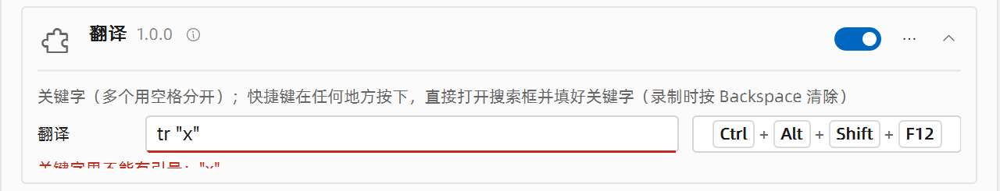

# #464 跨文件夹多选的系统右键菜单、#466 插件命令的快捷键

- **#464**：结果里选中的几行不在同一个文件夹时，Windows 的右键菜单（“更多选项”、`Shift`+右键）以前只对当前这一行弹，所以没有对比软件的“比较”。现在跨文件夹也给出选中项共用的菜单（`SHCreateDefaultContextMenu`，桌面文件夹为父、各项绝对 PIDL）。
- **#466**：插件卡片上每条命令的关键字旁多了它自己的快捷键（`[Plugin.<id>] Hotkey.<command>=`）。在任何程序里按下，搜索框打开并填好这条命令的关键字；关键字还在时再按一次关闭。

## 验证

| 项目 | 结果 |
|---|---|
| `ctest -R "tst_shellcontext\|^tst_settings$\|tst_pluginhotkeys\|tst_pluginkeywords"` | 4 项全部通过。 |
| `tst_shellcontext`（新增，7 组数据） | 单个文件、同文件夹两个文件、两个文件夹里的文件、三层不同深度、文件加别处的文件夹、两处的文件夹、中文名：菜单都不是“只有第一项”的退回菜单，都有复制、剪切、删除、属性；按 Shift 的“删除”执行后**每一项**都没了（证明命令拿到的是全部选中项）。不存在的路径没有菜单、不执行。 |
| 探针 `menuprobe`（开发时，不入库） | 跨文件夹两个文件：菜单项与同文件夹时一致（含压缩软件、TortoiseSVN 等扩展项）；“复制”“剪切”后剪贴板里是两个文件；“复制文件地址”得到两行路径；“删除”两个都进回收站；“创建快捷方式”放在桌面（与资源管理器搜索结果一致）。 |
| `tst_settings::commandHotkeyPreference`（新增） | `Hotkey.<command>` 随插件分区读写；关着的插件保留但不参与注册；清除后不留空值；手改 INI 带空格、空值都能读。 |
| `tst_pluginkeywords`（`--preview-plugins --keyword-check`，扩充） | 卡片上录入 `Ctrl+Alt+B` → INI 写入、录制框显示；注册失败的原因显示在该行下面；清除后 INI 里没有这一项；最长的 `Ctrl+Alt+Shift+F12` 放得下。录制框与关键字框同一行、等高、间隔 12，150% 下落在整像素上（922 px）。100% 深色同样检查并看图。 |
| `WinShun.exe --probe-runtime <目录> --command-hotkey-check`（隔离配置，真实 App，与正在运行的 Win顺 并存） | 通过。三条命令的测试插件：`main` 的 `Ctrl+Alt+Shift+F19` 注册成功；`same` 用同一组键的另一种写法，被拒并写明“已用于‘按键 main’”；`bare` 没有关键字，不注册（`F18` 仍空闲）并写明原因。用 `SendInput` 真按：搜索框弹到前台，输入框里是 `wsk `；再按一次关闭。 |

未做：本机没装对比软件，“比较”这一项本身没有实拍；它和压缩软件的菜单项一样由外壳扩展根据全部选中项给出，上面的测试已证明全部选中项都交给了菜单。

卡片（150%，浅色）：

