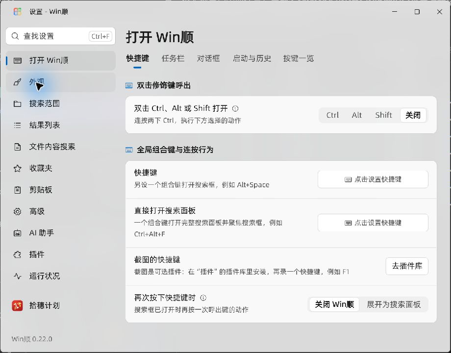
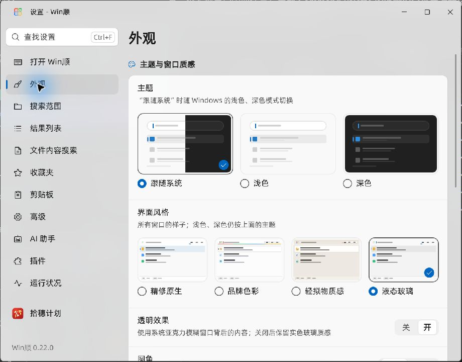
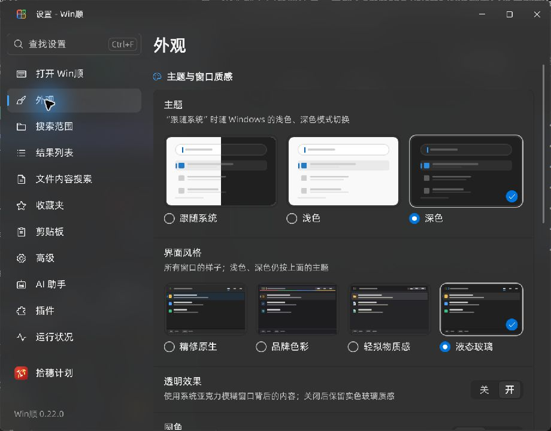
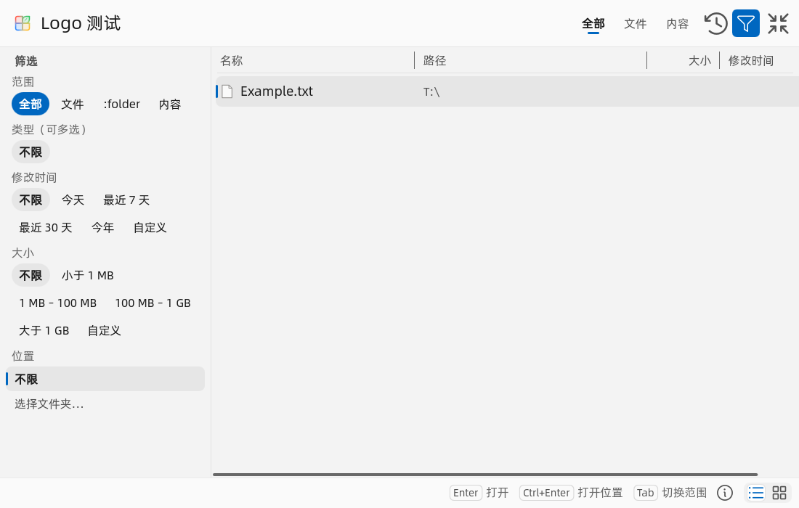
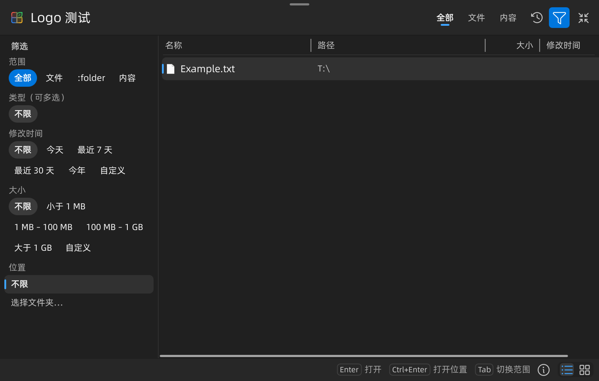

# 液态玻璃视觉修订验证

2026-11-07，Windows 11 / Qt 6.12.0 / MSVC 2022 x64 Release。验证当前工作区；不提交、推送或发布。历史初版截图保留在 `../issue235-20261107/`。

提交整理说明：以上记录描述验证发生时的状态。后续按用户要求提交 #235；Python 解释器识别、共享下拉菜单、历史图标和类型标签的既有修改未纳入该提交。第一轮记录中的两个下拉菜单探针来自当时工作区的独立修改，保留为实际验证记录，不代表本提交新增这两个测试。构建校验值对应当时工作区，不能视作仅从本提交构建的产物校验值。

## 结果

- 移除控件渐变与内层亮边，蓝灰色改为中性色；主搜索栏不套边框，文字页签用短标记，实际选项组保留分段底座。列表与导航保留中性选中底色和左侧强调色标记。
- 主程序、`WinShunCaptureApp`、`WinShunOcrSearchApp` 均构建成功，见 [构建记录](build.txt)。只验证插件共享主题的构建，未宣称插件业务全流程测试。
- [第一轮 12 项检查](tests.txt) 全部通过：浅色/深色/直角的按钮、风格选择器，圆角/直角下拉菜单，100%/125%/150%/200% 外观检查。包含真实控件的鼠标操作、键盘焦点、选择持久化和无障碍状态；QML 部件覆盖浅深色、圆角和实色回退。
- 真实窗口观察后仅提高浅色 `windowTint` 遮罩；最终重建，再次运行浅色按钮、浅色风格选择器和四档 DPI，共 [6 项全部通过](tests-final.txt)。桌面组合截图 opt-in 用例仍为跳过，不能计为通过。
- [托盘菜单相关 50 个用例](native-look.txt) 全部通过，覆盖四种风格的浅深色及直角。
- 生产 Main / Launcher 配合隔离样例数据，浅深色 `--search-logo` 各 123 项检查通过，0 QML warning。具体断言见 `search-logo-*.json`。这些是生产界面配合测试数据，不是用户索引的端到端搜索结果。
- 独立 `--probe-runtime --live --style liquid --renderer d3d11` 打开真实设置窗口，检查 Acrylic、卡片、分页、导航、输入和浅深色。没有退出或覆盖用户正在运行的 `dist/issue235` 程序。

## 截图

原生桌面截图直接保存 Computer Use 原始 JPEG；PNG 为程序探针输出，不能用于证明桌面背景模糊。

`native-light-before-tint.jpg` 保留浅色灰雾问题的中间证据；`picker-*.png` 是实色回退截图。控件断言与选择器断言分别见 `buttons-*.json`、`picker-*.json`。

## 产物与边界

- 构建复用 `build/ui-preview`，本任务日志、样例数据和探针目录位于 `build/liquid-refine-20261107/`。两次预览进程均已正常退出；用户实例未退出。最终预览的临时目录通过子进程 TEMP/TMP 放在该任务目录内。
- 最终预览同样在退出清理时触发已有 watcher 警告，见 [原生预览日志](native-preview.txt)。已核对明确绝对路径、非链接目录及预览进程退出；通过 PowerShell 清理 `F:\电脑便捷工具\build\liquid-refine-20261107\temp` 的请求被自动审批拒绝，唯一返回原因为 `blocked by policy`。未尝试其他机制；残留 `temp/WinShun-preview-1ac00868` 保留。警告发生在验证结束后的 profile 清理阶段，不代表控件绘制失败。
- 第一轮 live 探针自动清理时触发已有 watcher 清理警告，临时目录 `C:\Users\young\AppData\Local\Temp\WinShun-preview-c20fdb60` 有残留。此前同类目录清理已被自动审批以 `blocked by policy` 拒绝，本次没有改用其他机制绕过删除限制。它不属于用户配置。
- 未改窗口尺寸、业务流程、索引或用户配置；没有新发布版本。未做 Windows 10、高对比度、省电或耗电测试。
- 最终 `build/ui-preview/WinShun.exe` SHA256：`91AF628149CA033CCE3E4F1315673FD7531F25111ECEB2CC9F73FC2DD0DE2516`。
