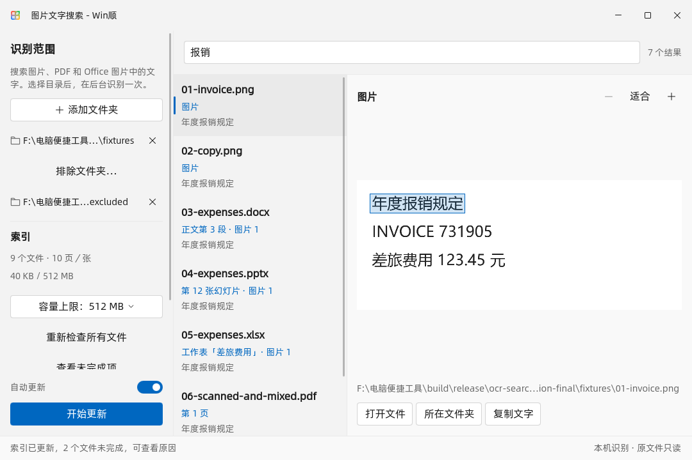

# 图片文字搜索插件验证 · 2026-11-01

本地开发版 `winshun.ocr-search 1.0.0`。本次没有发布 Release、提交／推送或更改正在运行的安装版配置。并行会话的画笔平滑改动保留，本记录不替其作功能验收。

## 环境与产物

- Windows 11 x64，MSVC 2022，Qt 6.12.0，Release，原生 Direct3D 11 与软件渲染。
- 共享 PP-OCR 组件来自测试运行目录。插件运行不依赖 Python 或 Office；样本生成工具使用 Pillow、python-docx、python-pptx、openpyxl、reportlab。
- 插件包：`dist/ocr-search-validation-20261101/winshun.ocr-search-1.0.0.wsplugin`，882,012 字节；SHA-256 `6affdcab677fc6984308fd5cdc2b2230358de228aa737affc13457beb23e59d3`。逐项文件哈希见 [package.json](package.json)。归档 CRC、清单、文件集合和 EXE／DLL 与测试版本的一致性已检查。
- 关键词入口兼容 0.17.0；自动合并到“内容”／已开启内容检索的“全部”需要本次新增提供者接口的宿主构建。公开插件库尚未上架。

## 自动验证

| 验证 | 结果与证据 |
|---|---|
| 完整 Release 构建 | 通过；收尾构建见 [构建日志](ocr-search-final-build.log)、[界面构建](ocr-search-ui-build.log) |
| OCR 专属测试 | 16 通过，0 失败、0 跳过（含初始化／清理）；[完整日志](ocrsearch-final-unit.txt) |
| 插件系统 | 145 通过，1 项需要管理员身份的作业／权限测试跳过；[最终日志](ocr-search-plugin-final.txt) |
| QML 静态检查 | 退出码 0；新增 QML 无告警，现有 DropMenu 与 ListWheelScroll 各有一条动态成员类型告警；[日志](ocr-search-qmllint-relative.log) |
| 真实窗口 | 五组均成功；[逐组数据、哈希](verification.json)，所有样本文件前后 SHA-256 一致 |

专属用例覆盖中文单字／双字、归一化、引号短语、误匹配核验、文件级跨页 AND、目录／日期／大小／排除条件、图片及文档去重、复制／移动／删除、旧修改时间、事务取消与恢复、Office 图片关联和重排 PPT 顺序、扫描／混排 PDF、外部链接忽略、损坏文件、工作进程取消／超时／恢复。实际调用本地 OCR；没有用模拟 OCR 结果替代这条链路。

安装接入用例实际生成 `.wsplugin`，经生产安装器检查和放置，在临时数据目录通过 `Host`／`WinShunPluginHost` 启动 strict 插件及其工作进程，自动索引、查询关键词和 Content，再请求打开真实 QML 窗口。校验动作数组的 Enter／Ctrl+Enter／Shift+Enter 顺序及协议预览字段。另有使用假插件的协议测试覆盖提供者范围、清单拒绝、内容触发、原生路径去重、超过普通推送配额、过期回答和停用。

全量 CTest 首轮 115 个测试目标中 103 通过、12 未通过，原始记录保留在 [首轮日志](ocr-search-ctest.log)，没有将其记作一次全绿：

- 离屏测试所需的 `qoffscreen.dll` 不在产品部署目录。设置测试专用 `QT_PLUGIN_PATH=C:\Qt\6.12.0\msvc2022_64\plugins` 和 `QT_QPA_FONTDIR=C:\Windows\Fonts` 后，录屏、按键、各缩放截图 UI、编辑器、标注模型及剪贴板图片测试均通过。
- `tst_plugin` 首轮并行运行出现一次堆异常，两次串行复核通过。检查发现测试 Fixture 默认销毁顺序会先释放日志／结果容器，随后 Host 退出时泵送事件，其回调仍捕获这些容器；现已显式先销毁 Host，最终完整插件测试再次通过。此修改限于测试夹具。
- 以上失败项的串行复核见 [复核日志](ocr-search-ctest-recheck.log)。其中启动测试仍因 `QLibraryInfo::BinariesPath` 在部署后的 Qt DLL 中指向部署目录的 `bin`、而那里没有测试要复制的 Qt DLL 失败，见 [具体断言](ocr-search-shelllaunch.txt)。把测试 EXE 隔离复制到临时目录并从 SDK 加载 Qt 后，12 通过、0 失败、4 项需准备第三方文件管理器窗口的用例跳过，见 [隔离复核](ocr-search-shelllaunch-isolated.txt)。未改动生产启动逻辑或用户程序。

Qt 自带工具的部分绝对中文路径参数无法打开文件；静态检查使用同一生成响应文件的相对路径版本。未修改产品路径规则。管理员及第三方程序交互等跳过项不作为已验证行为。

## 性能数据的适用范围

- 10,000 条**合成索引**，20 次交替查询，暖查询 P95 **33 ms**、最大 34 ms，数据库约 13.19 MiB。每条有独立实际临时文件供元数据检查；文字为生成数据，不代表扫描 10,000 份真实文档的耗时。
- 专属真实 OCR 小样本：3 张新图片约 **1,436 ms**。这是本机这批样本的测量值，不是通用吞吐量承诺。
- 真实窗口样本：7 个可检索文件、共 10 页／张、3 份去重图片数据；另外故意加入一个损坏 PDF、一个旧 DOC，因此统计为 9 个文件、1 失败、1 不支持。索引 40 KiB。DOCX 含正文及页眉图片，PPTX 图片在第 12 张，XLSX 有具名工作表，PDF 含扫描页与文字混排页，TIFF 为多页，另含图片副本及排除目录。
- 上述样本高度重复，不据此宣称比 AnyTXT 缩小固定比例。默认 512 MB 容量限制、压缩文字／识别框、图片指纹去重和不持久缓存原图均已实现；尚未以数万份真实用户文档做长期资源测试。

## 界面实测

使用生产窗口和独立配置；每次均真实索引、搜索“报销”、读取原图并验证高亮坐标，等待实际 Image Ready 后截取。校验实际 DPR、窗口尺寸、关键控件边界和最小预览尺寸；运行日志没有 QML 运行时告警。

| 模式 | 实际 DPR／逻辑尺寸 | 截图 |
|---|---|---|
| 浅色中文，D3D11 | 1.0／1080×720 | [查看](light-zh-1-1080/window.png) |
| 深色中文，D3D11 | 1.5／1080×720 | [查看](dark-zh-1.5-1080/window.png) |
| 浅色英文，D3D11 | 2.0／1080×720 | [查看](light-en-2-1080/window.png) |
| 深色英文，最小窗口 | 1.5／820×540 | [查看](dark-en-1.5-820/window.png) |
| 浅色中文，软件渲染 | 1.5／1080×720 | [查看](light-zh-1.5-1080-software/window.png) |



本记录为功能验证截图；没有更改 README 原有发布海报项目或两列图片格式。

## 重跑

在 MSVC 开发环境中从仓库根目录执行：

```powershell
cmake --build --preset release --parallel 6
./build/release/tst_ocrsearch.exe -o build/release/ocrsearch-unit.txt,txt
./build/release/tst_plugin.exe -o build/release/plugin-unit.txt,txt
python -X utf8 tools/verify_ocr_search.py --plugin build/release/WinShunOcrSearch.exe --app-dir build/release --output build/release/ocr-search-verification
```

窗口脚本仅使用指定输出目录内的生成样本和配置。格式支持、单文件限制和预览定位边界见 [插件说明](../../../src/ocr-search-plugin/package/README.md)。
